[한국어](https://github.com/imhyensuk/memopro/blob/main/README.md) · English

<p align="center">
  
</p>

<p align="center">
  <a href="https://pypi.org/project/memopro/"></a>
  <a href="https://crates.io/crates/memopro"></a>
  <a href="https://docs.rs/memopro"></a>
  <a href="https://github.com/imhyensuk/memopro/actions/workflows/ci.yml"></a>
  <a href="#license"></a>
  
  
</p>

<p align="center">
  
  
  
  
  
  
  
</p>

**memopro** is a Python and Rust library that runs language models, vision models and data jobs larger than memory within a memory ceiling the user sets, without changing their results.

---

## Contents

- **Phase 1. First look and philosophy**
  - [The problem](#the-problem)
  - [The approach](#the-approach)
  - [Results at a glance](#results-at-a-glance)
  - [Features](#features)
  - [Guarantees and five principles](#guarantees-and-five-principles)
  - [Who it is for](#who-it-is-for)
  - [Relation to other tools](#relation-to-other-tools)
- **Phase 2. Getting started**
  - [Platform support](#platform-support)
  - [Requirements](#requirements)
  - [Installation](#installation)
  - [Quick start](#quick-start)
- **Phase 3. Reference**
  - [Budget forms and settings](#budget-forms-and-settings)
  - [Command line (CLI)](#command-line-cli)
  - [Python, Rust and C API](#python-rust-and-c-api)
  - [Runtime API](#runtime-api)
  - [Advanced use](#advanced-use)
  - [Examples](#examples)
  - [API changes since 0.1.x](#api-changes-since-01x)
- **Phase 4. Performance and internals**
  - [Benchmarks](#benchmarks)
  - [How it works](#how-it-works)
  - [Limitations](#limitations)
  - [FAQ and troubleshooting](#faq-and-troubleshooting)
- **Phase 5. Project**
  - [Contributing](#contributing)
  - [Citation](#citation)
  - [License](#license)
  - [Changelog](#changelog)

---

# Phase 1. First look and philosophy

## The problem

> **On small-memory devices, large jobs stop.**
>
> On an 8-16 GB laptop or a free cloud GPU (an NVIDIA T4 with 15 GB), a model or dataset larger than memory stops the job with an out-of-memory (OOM) error. The usual remedies each have a price.
>
> - **Quantization** (4-bit, 8-bit): uses less memory but changes the model's outputs and accuracy, so results can no longer be compared with the original model.
> - **Operating-system swap**: keeps results the same but cannot be limited, writes gigabytes to the SSD again and again during the run, and can freeze the whole system.
> - **Model-specific offloading tools**: work only for certain models or tasks, and may exceed the memory they are given. Transformers' `device_map="auto"`, for example, used 7.05 GiB of host memory generating with a 14B model after being given 6 GiB of CPU memory.
<p align="right"><a href="#contents">↑ Back to contents</a></p>

## The approach

> **Trade time for memory, and bring data back only losslessly.**
>
> memopro takes data that is not in use out of memory and brings it back exactly as it was when it is needed. It chooses how by measuring the cost for each kind of data.
>
> - **Data with an original file, such as model weights**: dropped from memory and read again from the original file, checked against the original by digest on every read.
> - **Data made during the run**: compressed losslessly in memory, never written to the disk.
> - **Results computed from inputs that are still there**: dropped and computed again.
>
> The ceiling applies to the **whole process**, including Python, PyTorch and the tokenizer, not only to what memopro holds. A ceiling that cannot be kept is refused before the job starts, together with the ceiling that would work.
<p align="right"><a href="#contents">↑ Back to contents</a></p>

## Results at a glance

Every number below was measured against criteria fixed before the run. Raw results are in [`docs/research/data/`](https://github.com/imhyensuk/memopro/tree/main/docs/research/data), and the figures are drawn from those files by [`experiments/readme_figures.py`](https://github.com/imhyensuk/memopro/blob/main/experiments/readme_figures.py).

| Situation | Usual approach | memopro |
|---|---|---|
| 16-bit LoRA of Qwen2.5-7B (15.2 GB) on an **8 GB MacBook Air M1** | cannot be loaded (mlx-tune runs out of memory from 3B) | completes at a 4 GiB ceiling, 16.3 tokens/s, losses bit-identical whatever the ceiling, under 1 MiB written by memopro |
| Generation with Qwen2.5-14B (29.5 GB) on a **15 GB NVIDIA T4** | loaded normally: out of GPU memory; `device_map="auto"`: 71.3 s/token, 7.05 GiB peak with 6 GiB of CPU set | 55.9 s/token at a 6 GiB ceiling (1.27x faster), 5.88 GiB peak, same text |
| 16-bit LoRA of Qwen2.5-14B on a **15 GB NVIDIA T4** | loaded normally: out of GPU memory | completes at 6 GiB and 9 GiB, about 185 s per 512-token step, losses bit-identical at both ceilings |
| Generation with Qwen2.5-7B on an **8 GB M1** | 8.95 s/token without a draft | 2.37 s/token with a small draft model (3.8x), same output |
| Unchanged NumPy image job at **half the memory it needs** | OS swap: 2,300 MiB written to the SSD, 62.2 s | 0 bytes written, 14.8 s, same result |
| **Real-time audio** while other memory swaps | ordinary buffer: 3 missed deadlines (drop-outs) | `locked=True` buffer: none |

<picture>
  <source media="(prefers-color-scheme: dark)" srcset="https://raw.githubusercontent.com/imhyensuk/memopro/main/docs/images/fit-8gb-dark.svg">
  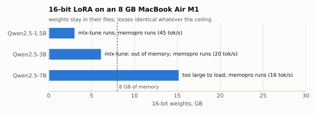
</picture>

<picture>
  <source media="(prefers-color-scheme: dark)" srcset="https://raw.githubusercontent.com/imhyensuk/memopro/main/docs/images/extreme-14b-t4-dark.svg">
  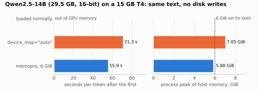
</picture>
<p align="right"><a href="#contents">↑ Back to contents</a></p>

## Features

| Feature | Description |
|---|---|
| LLM fine-tuning beyond memory | `memopro.finetune`: LoRA training on unchanged 16-bit weights, with an automatic batch that fits the ceiling |
| LLM generation beyond memory | `memopro.generate`: the same output as the model loaded normally, faster with a small draft model of the same family |
| Large vision models | `stream_model`: Hugging Face models such as DINOv2, ConvNeXtV2 and the vision parts of CLIP and SigLIP, even when larger than memory |
| Wrapping other tools' models | models loaded with Unsloth, Transformers or `mlx_lm.load` are trained and run the way that tool does; memopro only keeps the ceiling |
| A ceiling without code changes | `memopro run --budget 8GB script.py` runs NumPy and PyTorch scripts unchanged within the ceiling |
| A process-wide ceiling API | `memopro.enable(budget=...)` puts the whole process under a ceiling in one line |
| Diagnosis and prediction | `memopro doctor` and `Session.estimate()` tell whether a ceiling fits and how much slower the job will be |
| CSV sorting and joining beyond memory | `memopro.sort` / `memopro.join`, within the ceiling and without temporary files |
| Budgeted runtime | Python, Rust and C APIs that keep large arrays, tensors, modules and optimizers within a ceiling; `locked=True` pins real-time buffers in RAM |
| Swap-risk warning | warns at the start when the ceiling is above the memory free now, since other programs may then be swapped out |
<p align="right"><a href="#contents">↑ Back to contents</a></p>

## Guarantees and five principles

> **What memopro guarantees**
>
> 1. **Unchanged results**: generation and inference outputs are bit-identical to an ordinary run with enough memory. Training losses are bit-identical whatever the ceiling; they may differ from plain PyTorch training in the last bits because of the order of operations.
> 2. **A memory ceiling**: the whole process runs within the ceiling. A ceiling that cannot be kept is refused before the start with `BudgetExceeded`, which names a ceiling that works.
> 3. **Minimal disk writes**: no swap files, temporary files or converted weights during a run. The only thing written to the disk is a model downloaded once, and the amount is reported (`download="never"` turns that off).

> **Five principles behind the design**
>
> 1. **Minimal SSD writes**: apart from the first download of models, libraries and data, nothing memopro makes is written to the disk at gigabyte scale, including swap caused by overrunning memory.
> 2. **The ceiling the user sets**: any amount within the hardware (6 GB on a 128 GB machine is fine). The default is 80% of the machine's memory, and the ceiling that is set holds.
> 3. **A small, intuitive API**: few entry points and settings, no complicated combinations of options.
> 4. **Bit-identical to the user's original**: applying memopro changes neither results nor quality. A quantized model the user downloaded is itself the original and is reproduced exactly. There are no lossy modes.
> 5. **Research for speed**: new algorithms, structures and kernels are in scope when they make things faster without changing results.
<p align="right"><a href="#contents">↑ Back to contents</a></p>

## Who it is for

| Field | Uses |
|---|---|
| LLM research and development | 16-bit LoRA of 7B-14B models on laptops and small GPUs; unquantized baselines; comparisons that need reproducibility |
| Vision and multimodal | feature extraction and classification with large vision encoders |
| Data science | NumPy arrays larger than RAM and scikit-learn preprocessing scripts, unchanged; sorting and joining CSV files larger than memory |
| Teaching and self-study | large models on 8 GB laptops and free cloud GPUs |
| Real-time and systems work | buffers that must not wait, such as audio, pinned in RAM; a ceiling-keeping buffer runtime inside Rust and C programs |
<p align="right"><a href="#contents">↑ Back to contents</a></p>

## Relation to other tools

memopro focuses on running sizes that do not fit, unchanged and within a ceiling. In these cases other tools fit better.

| Situation | Better tool | Why |
|---|---|---|
| The model fits in GPU or main memory | Unsloth, mlx-tune, plain PyTorch | everything stays in memory and runs on dedicated kernels: much faster (T4 3B: Unsloth about 11x; M1 1.5B: mlx-tune 2.6x) |
| Accuracy loss is acceptable | QLoRA, llama.cpp (4-bit) | smaller weights mean less to read, so they run faster |
| Several GPUs or machines | DeepSpeed ZeRO, FSDP | built for distributed training |
| Random access over dataframes | DuckDB, Polars (streaming) | columnar engines designed for random access |

memopro also works with other tools. When a model loaded with a tool the user already uses is passed in, memopro keeps that tool's results and only keeps the ceiling.

| Tool | What is passed to memopro | What memopro does |
|---|---|---|
| Unsloth (`FastLanguageModel`) | the loaded model and `tokenizer=` | trains with Unsloth's LoRA layers and speed, and checks the process ceiling |
| Transformers | a loaded model or a model name | a name is streamed with the weights left in their files; a model is trained or run as it is |
| mlx-lm (`mlx_lm.load`) | the loaded model and `tokenizer=` | trains with mlx-lm's LoRA layers and loss, reading only the layers that do not fit from their files; results equal mlx-lm's training |
| Quantized models (bitsandbytes and others) | `memopro.load(..., quantization_config=...)` | loads exactly what was given; that model is the original |

<p align="right"><a href="#contents">↑ Back to contents</a></p>

---

# Phase 2. Getting started

## Platform support

| Platform | Support | Notes |
|---|---|---|
| macOS, Apple silicon (M1 or later) | everything | weights reach the Apple GPU (MPS) as no-copy Metal buffers |
| Linux x86_64 and aarch64 + NVIDIA GPU | everything | CUDA, with a GPU cache and the next layer copied ahead |
| Linux CPU | everything except GPU features | `memopro run`'s transparent paging uses userfaultfd |
| Windows x86_64 | CPU features (LLM training and generation, `sort`/`join`, the runtime) | no transparent paging in `memopro run`, no `locked=True` |

Measurements were made on an 8 GB MacBook Air M1, a Colab T4 (15 GB GPU, 12.7 GB RAM) and GitHub Actions Linux runners; Windows is tested in CI. The design does not depend on the memory size.
<p align="right"><a href="#contents">↑ Back to contents</a></p>

## Requirements

| Item | Requirement |
|---|---|
| Python | 3.11 or later (CI runs 3.11, 3.12 and 3.14) |
| PyTorch | 2.4 or later (AI features: `finetune`, `generate`, `stream_model`, ...) |
| Transformers, PEFT | installed by `memopro[llm]` (LLM training and generation) |
| Rust | 1.85 or later (to build from source where no wheel exists, or to use the crate) |
| Memory | no minimum; the ceiling is set by the user within the machine's memory |
| Disk | room for the first model download (a 7B model in 16 bits is 15.2 GB); nothing is written during runs |
| GPU | optional: Apple silicon GPU or NVIDIA CUDA GPU (verified on a T4) |
<p align="right"><a href="#contents">↑ Back to contents</a></p>

## Installation

**Python**

```bash
pip install memopro            # runtime, memopro run, enable, sort/join, diagnosis
pip install "memopro[llm]"     # + finetune, generate (PyTorch, Transformers, PEFT)
```

| Extra | Includes |
|---|---|
| `memopro[numpy]` | NumPy |
| `memopro[torch]` | PyTorch, NumPy |
| `memopro[hf]` | PyTorch, Transformers, Accelerate, safetensors |
| `memopro[llm]` | `hf` + PEFT, torchao |
| `memopro[mlx]` | MLX, mlx-lm (Apple silicon) |

PyPI has wheels for macOS arm64, Linux x86_64 and aarch64, and Windows x86_64. Elsewhere the package builds from source with a Rust toolchain.

**Rust**

```bash
cargo add memopro
```

**C**

```bash
git clone https://github.com/imhyensuk/memopro.git && cd memopro
cargo build -p memopro-c --release
# header:  crates/memopro-c/include/memopro.h
# library: target/release/libmemopro_c.{so,dylib,a}
```
<p align="right"><a href="#contents">↑ Back to contents</a></p>

## Quick start

### 1. Train and generate with a language model (Python)

The first run downloads the public model Qwen2.5-0.5B (about 1 GB) from Hugging Face once; no token is needed, and later runs read the cache. The device is chosen automatically (NVIDIA GPU, then Apple GPU, then CPU). On an Apple silicon Mac it takes about 1-2 minutes.

```python
import memopro

texts = [
    "memopro runs models that are larger than the memory of the machine.",
    "It reads each layer's weights from the file only while that layer runs.",
] * 8

r = memopro.finetune("Qwen/Qwen2.5-0.5B-Instruct", texts, budget="1GiB", seq_len=64)
print("losses:", [round(x, 3) for x in r.losses])
print(memopro.generate(r.model, "What does memopro do?", max_new_tokens=30))
r.adapter.save_pretrained("my-lora")  # a standard PEFT adapter
```

Models larger than the ceiling train with the same code; only the model name and ceiling change, for example `"Qwen/Qwen2.5-7B-Instruct"` with `budget="4GiB"` on an 8 GB Mac.

### 2. Run an existing script within a ceiling (Bash)

The script below normally uses about 2.4 GB (measured on macOS). Run unchanged through memopro, it gives the same result within 1 GB. It needs macOS or Linux and NumPy.

```python
# big_job.py: an ordinary NumPy program, no memopro code in it
import numpy as np

x = (np.arange(200_000_000, dtype=np.float32) % 1000) / 1000
y = np.sqrt(x) * 2
print("sum:", float(y.sum(dtype=np.float64)))
```

```bash
python big_job.py                          # peak about 2.4 GB
memopro run --budget 1GB big_job.py        # peak about 1 GB, same result
```

### 3. Set a ceiling in code (Python)

```python
import memopro

s = memopro.enable(budget="8GB")      # the whole process within 8 GB
# ... ordinary NumPy / PyTorch code ...
print(s.measured())                   # time taken, peak memory, any overrun
memopro.disable()
```

### 4. Check memory (Bash)

```bash
memopro doctor             # memory per device, RAM and disk, and the default ceiling
memopro doctor --json      # machine-readable
```

### 5. Use the runtime from Rust

```rust
use memopro::rt::{Config, Runtime};

let rt = Runtime::new(Config::new(256 << 20))?;   // 256 MiB ceiling for managed buffers
let id = rt.alloc(64 << 20, 4)?;                  // 64 MiB of float32-sized elements
rt.pin(id, true)?.as_mut_slice()?.fill(0);        // in memory only while pinned
println!("{:?}", rt.stats());                     // what was kept, compressed, re-read
```

### 6. Use the runtime from C

```c
#include "memopro.h"

mp_config cfg;
mp_config_default(&cfg, (uint64_t)2 << 30);          /* 2 GiB */
mp_runtime *rt;
mp_runtime_new(&cfg, &rt);
mp_buffer b;
mp_add_file(rt, "big.bin", 0, n, sizeof(float), &b);  /* a file region: re-read when needed */
mp_pin *p;
mp_pin_acquire(rt, b, 0, &p);
const float *x = (const float *)mp_pin_data(p);       /* valid until mp_unpin */
/* ... */
mp_unpin(p);
mp_runtime_free(rt);
```

<p align="right"><a href="#contents">↑ Back to contents</a></p>

---

# Phase 3. Reference

## Budget forms and settings

The ceiling (budget) takes the same forms everywhere: the `budget=` argument of every function, `--budget` on the command line, the settings file `memopro.toml` (or `$MEMOPRO_CONFIG`) and the environment variable `MEMOPRO_BUDGET`.

| Form | Meaning |
|---|---|
| `"auto"` | 80% of this machine's memory (of the container's limit if there is one); the default |
| `"6GB"`, `"4GiB"` | exactly that size, on a 128 GB machine as on a 16 GB one |
| `"50%"`, `0.5` | half of this machine's memory |
| `"device=8GB,host=24GB"` or `{"device": "8GB", "host": "24GB"}` | NVIDIA GPU memory and RAM separately (Apple silicon shares one pool) |

A ceiling above the memory free now is kept as given, with a note that other programs may be swapped out to make room. The 0.1.x forms `"-2GB"`, `"2GB..6GB"`, `"6GB!"`, `budget_basis` and `headroom` were removed in 0.2.0 and raise an error that shows the new form.

**Settings**

| Setting | Values | Default | Meaning |
|---|---|---|---|
| `budget` | the forms above | `"auto"` | the memory ceiling |
| `download` | `"auto"`, `"never"` | `"auto"` | whether a model not on the disk is downloaded once |
| `fallback` | `"stream"`, `"none"` | `"stream"` | whether `load` streams a model that does not fit the ceiling |
| `over_ceiling` | `"error"`, `"allow"` | `"error"` | when saved activations must come back and the ceiling has no room: stop, or give them back over the ceiling with a warning |
| `model_dirs` | list of folders | none | where draft models are looked for |

**Precedence** (later overrides earlier): defaults < `memopro.toml`/`$MEMOPRO_CONFIG` < `MEMOPRO_<NAME>` environment variables < `memopro.configure()` < a `with memopro.using(...)` block < arguments of the call

```toml
# memopro.toml
budget = "6GB"
download = "never"
model_dirs = ["~/models", "/Volumes/SSD/llm"]
```

```python
memopro.configure(budget="6GB", download="never")
with memopro.using(budget="2GB"):
    memopro.generate("Qwen/Qwen2.5-1.5B-Instruct", "Hello")
```
<p align="right"><a href="#contents">↑ Back to contents</a></p>

## Command line (CLI)

```bash
memopro doctor [--json] [--no-devices] [--budget BUDGET]
memopro run [--budget BUDGET] [--dry-run] [--report-json PATH] [--no-numpy] [--no-torch] script.py [args...]
memopro --version
```

| Command or option | Description |
|---|---|
| `memopro doctor` | memory and ceiling per device (GPU), host (RAM) and disk |
| `doctor --json` | machine-readable output |
| `doctor --no-devices` | skip GPU detection (does not import torch) |
| `memopro run script.py` | run a script unchanged within the ceiling |
| `run --budget` | the whole-process ceiling |
| `run --dry-run` | show what would be done without running |
| `run --report-json PATH` | write the report as JSON at the end |
| `run --no-numpy` / `--no-torch` | turn off paging of NumPy arrays / moving PyTorch activations |
| `run --keep-malloc-cache` | macOS: do not restart with `MallocLargeCache=0` |
| `run --keep-mps-heap` | Apple silicon: do not restart with the MPS memory setting |

Exit codes: 0 success, 1 memopro error, 2 usage error, 3 not implemented.
<p align="right"><a href="#contents">↑ Back to contents</a></p>

## Python, Rust and C API

**Python** (`import memopro`)

| Function | Description |
|---|---|
| `finetune(model, texts, *, tokenizer=None, budget="auto", device="auto", epochs=1, seq_len=512, batch=1, lr=2e-4, rank=8, alpha=16, targets=("q_proj","k_proj","v_proj","o_proj"), seed=0, checkpointing=True)` | LoRA training of an LLM larger than memory; returns a `FinetuneResult` (`model`, `adapter`, `losses`, `step_seconds`, `seconds`, `tokens`, `held_back`, `batch`). `batch="auto"` picks the largest batch that fits. Unsloth, Transformers or `mlx_lm.load` models can be passed with `tokenizer=` |
| `generate(model, prompt, *, tokenizer=None, budget="auto", device="auto", draft="auto", max_new_tokens=256, chat=True, streamer=None, stopping_criteria=None)` | generation with an LLM larger than memory; the output equals ordinary greedy generation. `draft` is a draft model (name, folder or model; `None` for none). `streamer` and `stopping_criteria` go to `model.generate` as given |
| `load(model_id, *, budget=..., fallback=..., **from_pretrained)` | loads a Hugging Face model exactly as stored (precision unchanged), streaming it if it does not fit; a `dtype=` or `quantization_config=` given is the original |
| `enable(budget=None, *, numpy=True, torch=True, transformers=True, **settings)` / `disable()` | a whole-process memory ceiling; returns a `Session` (`estimate()`, `measured()`, `summary()`) |
| `sort(path, key, *, out, budget="auto")` | sorts a CSV file larger than memory by one column; `out` is a path or a function that receives byte chunks |
| `join(left, right, on, *, out, budget="auto")` | joins two CSV files larger than memory on one column |
| `doctor(*, devices=True)` | the same report as `memopro doctor` |
| `configure(**settings)` / `using(**settings)` / `get_config()` | global settings / settings for a `with` block / the current settings |
| `report()` | the process-wide report |
| Errors | all derive from `MemoproError`: `BudgetExceeded` (`.suggestions`), `IntegrityError`, `InvalidArgument`, `ModeUnavailable`, `ConfigError`, `PolicyError`, `NotYetImplemented` |

**Rust** (the `memopro` crate, [docs.rs](https://docs.rs/memopro))

| Item | Description |
|---|---|
| `rt::Runtime::new(Config)` | the runtime that keeps buffers within a ceiling; `Config::new(budget)` with fields `compress_level`, `min_saving`, `policy`, `prefetch`, `lookahead`, `process_budget` |
| `Runtime::alloc(nbytes, elem)` / `alloc_locked(...)` | a new buffer / a buffer pinned in RAM |
| `Runtime::add_file(path, offset, nbytes, elem, ...)` | registers a file region, dropped and re-read (digest-checked) when memory is short |
| `Runtime::derive(inputs, nbytes, ...)` | a buffer computed from other buffers, recomputed when dropped and checked against the first result |
| `Runtime::pin(id, write)` → `Pin` | a buffer that stays at the same address while pinned (`as_slice`, `as_mut_slice`) |
| `prefetch`, `evict`, `free`, `state`, `nbytes`, `read_into` | per-buffer control and state (`BufferState`: `Resident`, `Compressed`, `Dropped`, `Unloaded`) |
| `Runtime::stats()` / `predict()` | what was kept, compressed and re-read / the extra time predicted from one recorded cycle |
| `rt::pager::Pager` (Linux, macOS) | transparent paging of an unchanged program's anonymous memory, compressed in memory |
| `rt::process_footprint()` | the process's memory now |
| `csv`, `codec`, `edr`, `hwinfo`, `verify` | CSV kernels, lossless compression (byte shuffle + zstd, EDR for bf16), machine memory, checks against originals |

**C** (`memopro-c`, `crates/memopro-c/include/memopro.h`)

| Functions | Description |
|---|---|
| `mp_config_default`, `mp_runtime_new`, `mp_runtime_free`, `mp_limit` | create and free a runtime, the current limit |
| `mp_alloc`, `mp_add_file`, `mp_derive`, `mp_free` | register and free buffers |
| `mp_pin_acquire`, `mp_pin_data`, `mp_pin_size`, `mp_unpin` | pin and access buffers |
| `mp_prefetch`, `mp_evict`, `mp_state`, `mp_nbytes` | per-buffer control |
| `mp_stats_get`, `mp_predict` | statistics and prediction |
| `mp_version`, `mp_abi_version`, `mp_last_error` | versions and the last error |

Every function returning `int` returns `MP_OK` (0) or a negative error code (`MP_ERR_BUDGET`, `MP_ERR_INTEGRITY`, ...). All functions are thread-safe.
<p align="right"><a href="#contents">↑ Back to contents</a></p>

## Runtime API

The Python runtime (`memopro.rt`) is for handing large arrays and tensors to a ceiling directly.

| Name | Description |
|---|---|
| `Runtime(budget="auto", *, compress_level=1, min_saving=0.15, policy="reuse", prefetch=True, lookahead="64MiB", process_budget=None)` | the runtime that keeps buffers within a ceiling |
| `Runtime.load_npy(path)` / `.add_file(...)` | buffers backed by a file, re-read from the original when needed (digest-checked) |
| `Runtime.array(shape, dtype, locked=False)` / `.alloc(...)` | new buffers, compressed losslessly while unused; `locked=True` pins them in RAM (macOS, Linux) |
| `Buffer.view(write=False)` | a no-copy NumPy view, in memory only while in use (`with` block) |
| `Runtime.derive(...)` | a buffer computed from other buffers |
| `Runtime.adopt(obj, threshold="1MiB")` | hands an object holding tensors, modules, optimizers or arrays to the runtime; it wakes inside `with h:` |
| `Runtime.stats()` / `.report()` / `.predict()` / `.limit()` / `.hold_back()` | statistics, report, prediction, current limit, shrinking the limit |
| `memopro.rt.torch.stream_model(name, *, budget="auto", device="cpu", model_class=None, revision=None, gpu_budget="auto", prefetch=True, lookahead="64MiB")` | runs a Hugging Face model with its weights left in their files |
| `memopro.rt.torch.draft_model(name, *, target=None, device="mps")` | a draft model for faster generation (Apple GPU: int4; NVIDIA GPU: 16-bit) |
| `memopro.rt.torch.generate(model, input_ids, *, draft=None, **kwargs)` | draft-verified generation with the same output as ordinary greedy `generate` |
| `memopro.rt.torch.causal_lm_loss`, `enable_checkpointing`, `saved_weights` | loss, checkpointing and weight-reference helpers for writing a training loop over a streamed model |
| `memopro.rt.process_footprint()` / `process_peak_footprint()` | the process's current and peak memory |
<p align="right"><a href="#contents">↑ Back to contents</a></p>

## Advanced use

### Training speed: `batch="auto"`

```python
r = memopro.finetune("Qwen/Qwen2.5-7B-Instruct", texts, budget="4GiB", batch="auto")
print(r.batch)                           # the batch chosen
```

Streamed weights are read once per step, so a larger batch means less time per token. Results are identical across ceilings for the same batch.

### Generation speed: draft models

```python
text = memopro.generate("Qwen/Qwen2.5-7B-Instruct", "Summarize: ...",
                        budget="2GiB", draft="Qwen/Qwen2.5-1.5B-Instruct")
```

A small model proposes tokens and the large one verifies them together; the output equals the large model's alone. The draft must use the same tokenizer.

With `draft="auto"` (the default), memopro looks among the models already on the disk for one with the same tokenizer and about a fifth of the size. It looks in three places:

1. the folders in the `model_dirs` setting
2. for a model loaded from a folder, the folders next to it
3. the Hugging Face cache

If none fits and the model must be streamed for every token (Apple GPU), an int4 copy of the model itself is made in memory and used as the draft; nothing is written to the disk, and the output is the same. On NVIDIA GPUs a draft is used only when it gains more than the GPU cache it takes.

### Models loaded by other tools

```python
from unsloth import FastLanguageModel
model, tok = FastLanguageModel.from_pretrained("unsloth/Qwen2.5-3B-Instruct", load_in_4bit=False)
r = memopro.finetune(model, texts, tokenizer=tok, seq_len=512)   # Unsloth's LoRA layers and speed + the process ceiling
```

```python
import mlx_lm
model, tok = mlx_lm.load("Qwen/Qwen2.5-3B-Instruct")
r = memopro.finetune(model, texts, tokenizer=tok, budget="2.5GiB")  # same results as mlx-lm's training
print(memopro.generate(model, "Hello", tokenizer=tok, budget="2.5GiB"))
```

### Vision models

```python
import transformers
import memopro.rt.torch as rtt

m = rtt.stream_model("facebook/dinov2-giant", budget="1GB", device="cuda",  # "mps", "cpu"
                     model_class=transformers.Dinov2Model)
features = m(pixel_values=images).pooler_output
```

With `model_class=transformers.SiglipVisionModel` and similar, only the vision part of a CLIP or SigLIP checkpoint runs.

### Prediction before running

```python
s = memopro.enable(budget="8GB")
print(s.estimate(sample, total="12GB", passes=3))   # before: does it fit, how many extra seconds
...                                                 # NumPy / PyTorch code
print(s.measured())                                 # after: time taken, peak memory, any overrun
```

`estimate` measures the compression ratio and speed on a sample and computes how many extra seconds the whole job will take within the ceiling.

### Handing data to the runtime

```python
from memopro.rt import Runtime

rt = Runtime(budget="2GB")
big = rt.load_npy("big.npy")                 # backed by its file: re-read when needed (digest-checked)
work = rt.array((50_000, 4_096), "float32")  # a new buffer: compressed losslessly while unused
with work.view(write=True) as a:             # a NumPy view, in memory only while in use
    a[:] = 1.0

h = rt.adopt(model)          # hand over an existing model (tensors, modules, optimizers, arrays)
with h:                      # awake only inside the block; compressed losslessly otherwise
    out = model(x)
```

### Sorting and joining CSV files larger than memory

```python
import hashlib, memopro

memopro.sort("events.csv", key="user_id", out="sorted.csv", budget="8GB")

h = hashlib.sha256()  # receive the output in a function instead of a file
memopro.join("events.csv", "users.csv", on="user_id", out=h.update, budget="8GB")
```

No temporary files are written; the originals are read again as often as needed. Each block is checked against the CRC of its first read, so a file that changes midway gives an error instead of a wrong result. Rows held at once are compressed losslessly when the ceiling is reached.

- **Input**: RFC 4180 CSV with a header row, `,` separators, quoted fields holding commas, newlines or `""`, and `\n` or `\r\n` line ends.
- **Key comparison**: numeric when every value in the file is an integer, otherwise byte order (the same as `LC_ALL=C sort`).

### Pinning real-time buffers

```python
from memopro.rt import Runtime

rt = Runtime(budget="1GB")
samples = rt.array((48_000 * 60,), "int16", locked=True)  # never compressed or swapped
```

### Apple GPU memory setting

On Apple GPUs, call `finetune` or `stream_model` before any other MPS work, so memopro can apply the setting that shrinks the PyTorch MPS allocator's spare heap (about 1 GiB). `memopro run` applies it automatically by restarting the script.
<p align="right"><a href="#contents">↑ Back to contents</a></p>

## Examples

| Path | Contents |
|---|---|
| [`examples/quickstart.ipynb`](https://github.com/imhyensuk/memopro/blob/main/examples/quickstart.ipynb) | a five-minute tour; runs on a CPU in a minute and downloads nothing |
| [`examples/colab_extreme_14b.ipynb`](https://github.com/imhyensuk/memopro/blob/main/examples/colab_extreme_14b.ipynb) | a 14B model that does not fit a Colab T4: loaded normally, `device_map="auto"` and memopro |
| [`examples/colab_t4_suite_*.ipynb`](https://github.com/imhyensuk/memopro/tree/main/examples) | Colab T4 test suites: language models, vision, speed (GPU cache), data programs |
| [`examples/colab_t4_unsloth.ipynb`](https://github.com/imhyensuk/memopro/blob/main/examples/colab_t4_unsloth.ipynb), [`colab_t4_beat.ipynb`](https://github.com/imhyensuk/memopro/blob/main/examples/colab_t4_beat.ipynb), [`colab_unsloth_bits.ipynb`](https://github.com/imhyensuk/memopro/blob/main/examples/colab_unsloth_bits.ipynb) | the same 16-bit LoRA as Unsloth, sizes Unsloth cannot run, the source of bit differences |
| [`examples/colab_model_families.ipynb`](https://github.com/imhyensuk/memopro/blob/main/examples/colab_model_families.ipynb) | whether generation and training of several model families match ordinary runs |
| [`examples/colab_e069.ipynb`](https://github.com/imhyensuk/memopro/blob/main/examples/colab_e069.ipynb) | sorting and joining a 30 GB CSV at an 8 GB ceiling |
| [`examples/colab_windows_local.ipynb`](https://github.com/imhyensuk/memopro/blob/main/examples/colab_windows_local.ipynb) | limit tests and comparisons on a Windows PC (CPU) |
| [`examples/colab_t4/`](https://github.com/imhyensuk/memopro/tree/main/examples/colab_t4), [`examples/windows_local/`](https://github.com/imhyensuk/memopro/tree/main/examples/windows_local) | the source scripts of those notebooks (generated by `build.py`) |
| [`experiments/`](https://github.com/imhyensuk/memopro/tree/main/experiments) | measurement scripts; results go to `docs/research/data/<experiment>/` |
| [`docs/guide/`](https://github.com/imhyensuk/memopro/blob/main/docs/guide/README.en.md) | the user guide, from installation to how it works |

The Colab notebooks save their results to Google Drive and resume where they stopped when run again.
<p align="right"><a href="#contents">↑ Back to contents</a></p>

## API changes since 0.1.x

**Removed** (using them raises an error that says what to use instead)

| Removed | Use instead |
|---|---|
| `check`, `train_session`, `optimize` | `finetune`, or ordinary code inside `memopro.enable()` |
| `hibernate`, `census`, `elastic`, the technique registry, notebook magics | `Runtime.adopt`, `memopro.enable()` |
| CLI `memopro check` | `memopro doctor`, `memopro run --dry-run` |
| Disk-writing features (spill, file residency, disk offload, `fallback="stored"`, `disk_writes`, ...) | none: memopro writes nothing to the disk besides downloads |
| Automatic lossy choices (`quality`, `prefer`) | none: int4, int8 and half are never chosen for the user; the precision given is the original |
| Budget forms `"-2GB"`, `"2GB..6GB"`, `"6GB!"`, `{use, min, max}`, `budget_basis`, `headroom` | `"auto"`, `"6GB"`, `"50%"`, `"device=…,host=…"` |

**Added**

| Name | What it does |
|---|---|
| `finetune`, `generate` | training and generation of LLMs larger than memory (including Unsloth, Transformers and mlx-lm models) |
| `enable` / `disable` | a whole-process ceiling |
| `sort` / `join` | CSV files larger than memory |
| `Runtime.adopt`, `alloc(..., locked=True)` | handing objects over, pinning real-time buffers |
| `memopro run` | a ceiling without code changes (Linux, macOS) |
| Windows wheels | CPU features |

<p align="right"><a href="#contents">↑ Back to contents</a></p>

---

# Phase 4. Performance and internals

## Benchmarks

### Memory over time: 7B training on an 8 GB Mac

<picture>
  <source media="(prefers-color-scheme: dark)" srcset="https://raw.githubusercontent.com/imhyensuk/memopro/main/docs/images/train-7b-8gb-dark.svg">
  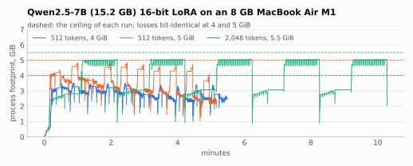
</picture>

While a 15.2 GB model trains on an 8 GB machine, the process footprint rises and falls as weights are read and dropped each step, and never crosses the ceiling (dashed). At 2,048 tokens the attention scores keep it near the ceiling during the backward pass.

| Case | Ceiling | Step time | Tokens/s | Peak | Losses |
|---|---|---|---|---|---|
| 512 tokens × 10 steps | 4 GiB | 31.5 s | 16.3 | 3.55 GiB | bit-identical to 5 GiB |
| 512 tokens × 10 steps | 5 GiB | 29.6 s | 17.3 | 4.86 GiB | bit-identical to 4 GiB |
| 2,048 tokens × 5 steps | 5.5 GiB | 121.4 s | 16.9 | 5.06 GiB | completed |

### Generation larger than memory on an 8 GB Mac

<picture>
  <source media="(prefers-color-scheme: dark)" srcset="https://raw.githubusercontent.com/imhyensuk/memopro/main/docs/images/generation-8gb-dark.svg">
  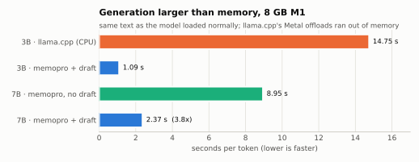
</picture>

The output equals the model loaded normally. llama.cpp ran out of memory with every Metal offload and ran on the CPU only.

### The whole process stays within the ceiling

<picture>
  <source media="(prefers-color-scheme: dark)" srcset="https://raw.githubusercontent.com/imhyensuk/memopro/main/docs/images/ceiling-dark.svg">
  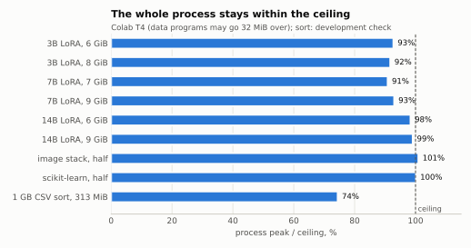
</picture>

| Job (environment) | Ceiling | Peak |
|---|---|---|
| 3B 16-bit LoRA (Colab T4) | 6 / 8 GiB | 5.56 / 7.34 GiB |
| 7B 16-bit LoRA (Colab T4; 7B does not fit a T4 loaded normally) | 7 / 9 GiB | 6.36 / 8.37 GiB |
| 14B 16-bit LoRA (Colab T4, 29.5 GB model) | 6 / 9 GiB | 5.90 / 8.92 GiB |
| Image stack at half memory (Colab) | 403 MiB | 407 MiB (within the +32 MiB allowance) |
| scikit-learn at half memory (Colab) | 1,220 MiB | 1,222 MiB |
| 1 GB CSV sort (M1, development check) | 313 MiB | 233 MiB |

### Half the memory, unchanged programs, zero bytes on the SSD

<picture>
  <source media="(prefers-color-scheme: dark)" srcset="https://raw.githubusercontent.com/imhyensuk/memopro/main/docs/images/half-memory-dark.svg">
  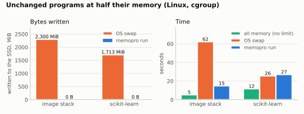
</picture>

| Job | SSD writes: OS swap / memopro | Time: all memory / OS swap / memopro |
|---|---|---|
| Image stack | 2,300 MiB / 0 | 5.3 / 62.2 / 14.8 s |
| scikit-learn classification | 1,713 MiB / 0 | 11.7 / 25.5 / 27.0 s |

Linux runner, cgroup limit = half the plain run's peak.

### Real-time audio does not drop out while other memory swaps

<picture>
  <source media="(prefers-color-scheme: dark)" srcset="https://raw.githubusercontent.com/imhyensuk/memopro/main/docs/images/audio-locked-dark.svg">
  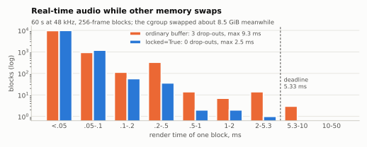
</picture>

| Case | Drop-outs | Render p99 / max | Major faults |
|---|---|---|---|
| No pressure, ordinary buffer | 0 | 0.06 / 0.24 ms | 0 |
| Pressure, ordinary buffer | 3 | 0.30 / 9.34 ms | 549 |
| Pressure, `locked=True` | 0 | 0.09 / 2.53 ms | 75 (Python's own code pages) |

### Lossless compression ratio and speed

<picture>
  <source media="(prefers-color-scheme: dark)" srcset="https://raw.githubusercontent.com/imhyensuk/memopro/main/docs/images/compression-dark.svg">
  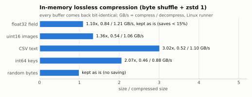
</picture>

Data that barely shrinks (saves under 15%) is kept as it is. Every buffer came back bit-identical. On an Apple M1 the ratios were the same at about twice the speed (CSV: 0.98 GB/s compress, 3.23 GB/s decompress).

### Calling from other languages

<picture>
  <source media="(prefers-color-scheme: dark)" srcset="https://raw.githubusercontent.com/imhyensuk/memopro/main/docs/images/ffi-dark.svg">
  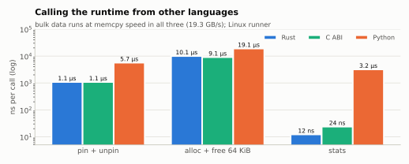
</picture>

### Full table

| Job | Environment | Result |
|---|---|---|
| Qwen2.5-14B generation (29.5 GB) | NVIDIA T4, 15 GB | 55.9 s/token after the first at a 6 GiB ceiling, peak 5.88 GiB, no disk writes; `device_map="auto"`: 71.3 s/token, peak 7.05 GiB with 6 GiB of CPU set; same output |
| Qwen2.5-14B LoRA training | NVIDIA T4, 15 GB | 190 / 183 s per 512-token step at 6 / 9 GiB ceilings, losses bit-identical across ceilings |
| Qwen2.5-7B LoRA training | Apple M1, 8 GB | 16.3-17.3 tokens/s at 4-5.5 GiB ceilings (512 and 2,048 tokens) |
| Qwen2.5-7B LoRA training | Apple M1, 8 GB | 15.5 tokens/s at a 2.5 GiB ceiling with `batch=4` |
| Mistral-7B LoRA training | NVIDIA T4, 15 GB | about 43 tokens/s at a 4 GiB ceiling |
| Qwen2.5-7B generation (with a draft) | Apple M1, 8 GB | 8.95 → 2.37 s/token, same output |
| Qwen2.5-7B generation (no draft) | NVIDIA T4, 15 GB | 1.04x a plain run after the first token (0.066 vs 0.064 s/token), same output, peak 2.32 GiB (plain 3.58 GiB) |
| Qwen2.5-3B LoRA training | Apple M1, 8 GB | 20 tokens/s (mlx-tune runs out of memory) |
| Qwen2.5-3B LoRA training, a model from `mlx_lm.load` | Apple M1, 8 GB | 22.8 tokens/s at a 2.5 GiB ceiling, losses and adapters bit-identical to mlx-lm's training (mlx-lm alone: 1.8 tokens/s, +0.9 GB of swap) |
| 1.5B-3.8B models (Qwen2.5, SmolLM2, Phi-3.5) | NVIDIA T4, 15 GB | 1.00-1.03x the time of a run with ample memory for training, 1.06-1.35x for generation |
| NumPy, scikit-learn and CSV jobs at 50-75% of the memory they need | Linux | same results, 1.1-3.4x the time |
| The same 3B LoRA at a size that fits the GPU | NVIDIA T4 | Unsloth 0.45 s/step vs memopro 5.1 s/step (Unsloth about 11x faster) |

**Models verified**: Qwen2.5 (1.5B-14B), Qwen3, Qwen3.5, Llama 3.2, Gemma 3, Phi-2, Phi-3, Phi-3.5, Granite, SmolLM2, SmolLM3, DeepSeek-R1-Distill (Qwen architecture), Mistral-7B, DINOv2, ConvNeXtV2, ResNet-152. For each family the generated text matched the ordinary run, and training losses were identical across ceilings.
<p align="right"><a href="#contents">↑ Back to contents</a></p>

## How it works

At the core of memopro is a Rust runtime. For each large buffer it records how the buffer can be brought back, and when the ceiling is reached it takes out of memory the buffers that are cheapest to bring back.

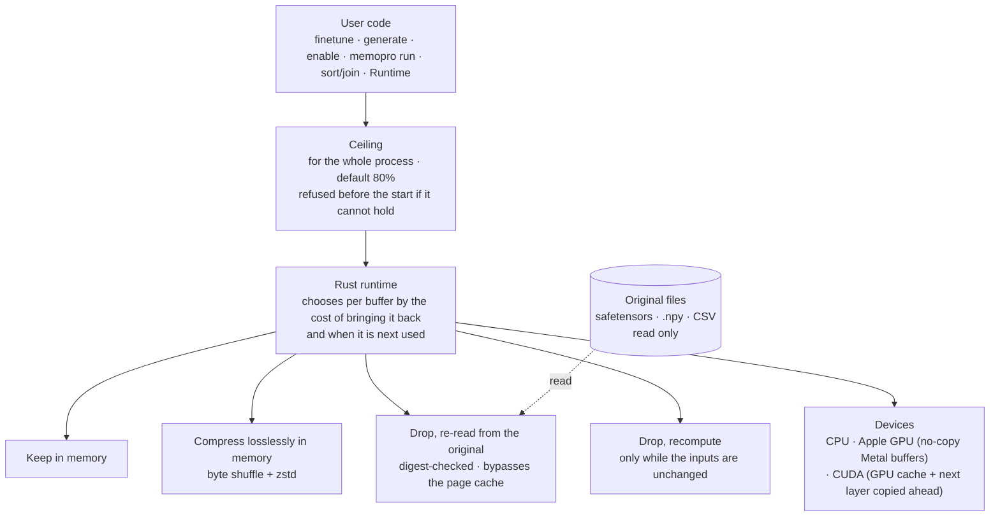

This is how one layer of a streamed model is computed:

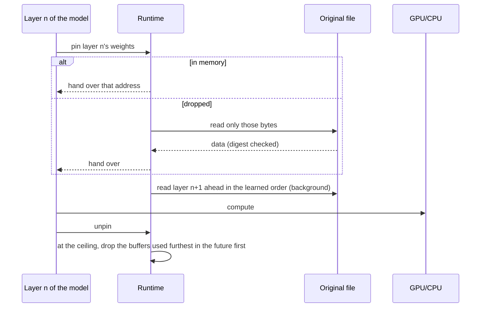

**Components**

- **The ceiling**: set from the machine's memory (or the container's limit) and enforced by measuring the process's real footprint (macOS `phys_footprint`, Linux RSS, Windows working set), shrinking the runtime's share as the rest of the process grows.
- **Streaming (`stream_model`)**: builds only the skeleton of a Hugging Face model and reads each weight from its region of the safetensors file only while its layer computes; it learns the forward order and reads the next layer ahead.
- **Per-device paths**
  - Apple GPU: runtime memory is handed over as no-copy Metal buffers.
  - NVIDIA GPU: as many weights as fit stay in an automatic GPU cache, and the rest are copied ahead on a side stream. Training keeps room for the largest weight outside the cache.
- **Training memory**: layer checkpointing keeps activations small, and activations are estimated before the first step, so a ceiling that cannot hold them is refused before the start.
- **Transparent paging (`memopro run`)**: an unchanged program's large allocations live in a runtime region and come back on page faults (Linux userfaultfd, macOS signals). Memory taken out is only compressed, never written to the disk.
- **Draft-verified generation**: a small model proposes several tokens and the large model verifies them row by row, giving output bit-identical to ordinary greedy generation.

## Limitations

- **Models far larger than memory are slow.** They run, but storage read speed sets the pace; on an NVIDIA T4, 14B generates about one token a minute and 16-bit LoRA trains at about 3 tokens/s.
- **When the model fits in memory, dedicated tools are much faster.** On a T4 with 3B Unsloth was about 11x faster, and on an M1 with 1.5B mlx-tune 2.6x. memopro's strength is running what does not fit, unchanged and within the ceiling.
- **A ceiling above the free memory may push other programs into swap.** memopro keeps within its ceiling, but the operating system may move other programs to the disk to make room: training 7B at 4-5 GiB ceilings on an 8 GB M1 grew system swap by 0.5-1.2 GB. `finetune` and `generate` warn about this at the start.
- **Random-access data work may be slow or exceed the ceiling.** This includes unchanged pandas dataframe manipulation and Polars. For sorting and joining large CSV files use `memopro.sort`/`memopro.join`.
- **The reference for training losses**: on CUDA, losses are identical across ceilings but may differ from plain PyTorch training in the last bits from step 2.
- **MoE models are not supported.** Models that fuse expert weights (Qwen3-MoE, Qwen3-Next, DeepSeek V2 and V4, Kimi Linear, GLM4-MoE, MiniMax M2, ...) cannot be streamed from a folder and are refused with an error.
- **Bit-identity with Unsloth is not claimed.** Unsloth training differs in bits from run to run from the first backward pass, even on its own. On a T4 with 3B the starting adapter and first loss matched, and later loss differences (within about 0.0005) were indistinguishable from those between Unsloth runs.
- **`locked=True` pins data buffers only.** To pin the program's code as well, the program must call `mlockall` itself.
- **On Windows**, `memopro run`'s transparent paging and `locked=True` are not available.

## FAQ and troubleshooting

<details>
<summary><b>Are the results really the same with memopro?</b></summary>

Generation and inference are bit-identical to an ordinary run with enough memory, which the tests (`tests/`) and measurements check. Training losses stay bit-identical when the ceiling changes; against plain PyTorch training the last bits may differ because of the order of operations. memopro never chooses a result-changing method such as 4-bit for the user.
</details>

<details>
<summary><b>What does it write to the disk?</b></summary>

Only a model downloaded once on the first run (into the Hugging Face cache), and the amount is reported. No swap files, temporary files or converted weights are written during runs. To block downloads too, use `memopro.configure(download="never")` or `MEMOPRO_DOWNLOAD=never`.
</details>

<details>
<summary><b>I get a <code>BudgetExceeded</code> error.</b></summary>

The ceiling is below the minimum the job needs: the largest single weight, one step's activations and the process itself. The error's `.suggestions` and message give a ceiling that really works. Raise the ceiling to that, or lower `seq_len` or `batch`.
</details>

<details>
<summary><b>A warning says "the ceiling ... is above the ... free now".</b></summary>

The ceiling is above the memory free right now. memopro will keep within it, but the operating system may push other programs into swap. Close other programs or lower the ceiling; `memopro doctor` shows the memory free now.
</details>

<details>
<summary><b>It is too slow.</b></summary>

When the model is much larger than the ceiling, weights are read from storage every step, so slowness is expected. Things to try:

- Training: `batch="auto"`, so each read of the weights serves more tokens.
- Generation: a small draft model of the same family (`draft=`).
- A larger ceiling, so more weights stay in memory.
- If the model fits in memory, dedicated tools such as Unsloth or mlx-tune are faster.
</details>

<details>
<summary><b>On an Apple GPU more memory is taken than expected.</b></summary>

PyTorch's MPS allocator keeps a spare heap of about 1 GiB when there is no pressure. Call `finetune` or `stream_model` before any other MPS work so memopro can apply the setting that shrinks it; `memopro run` restarts the script with that setting (`--keep-mps-heap` turns it off).
</details>

<details>
<summary><b>Can I use quantized (4-bit, 8-bit) models?</b></summary>

Yes. A `quantization_config=` or `dtype=` passed to `memopro.load` is taken as the original and loaded exactly as given. memopro never quantizes on the user's behalf.
</details>

<details>
<summary><b>An MoE model is refused.</b></summary>

0.2.0 does not stream MoE models that fuse expert weights. Use a dense model.
</details>

<details>
<summary><b><code>memopro run</code> does not work on Windows.</b></summary>

Windows has no transparent paging. LLM training and generation, `sort`/`join` and the runtime API (`memopro.rt`) work on Windows.
</details>

<details>
<summary><b>Installation asks for Rust.</b></summary>

Platforms without a wheel build from source and need Rust 1.85 or later. Install it with [rustup](https://rustup.rs) and try again.
</details>

<p align="right"><a href="#contents">↑ Back to contents</a></p>

---

# Phase 5. Project

## Contributing

Report bugs and suggest ideas in [Issues](https://github.com/imhyensuk/memopro/issues); send code as pull requests. Discussing large changes in an issue first is recommended.

**Development setup**

```bash
git clone https://github.com/imhyensuk/memopro.git && cd memopro
python3 -m venv .venv && .venv/bin/pip install "maturin>=1.9,<2" pytest ruff
VIRTUAL_ENV=$PWD/.venv .venv/bin/maturin develop --release   # build the Rust extension
```

**Checks that must pass before a pull request**

```bash
.venv/bin/pytest -q
.venv/bin/ruff check python tests && .venv/bin/ruff format --check python tests
cargo fmt --all --check && cargo clippy --workspace --all-targets -- -D warnings && cargo test -p memopro
```

**Rules**

- New features and bug fixes come with tests.
- `import memopro` has no side effects and does not import torch or numpy.
- The lossless principle holds: a result-changing method can never be a default.
- No feature may write data memopro makes to the disk.
- The public API stays small; discuss new names in an issue first.
<p align="right"><a href="#contents">↑ Back to contents</a></p>

## Citation

If you use memopro in research, please cite it with the repository's **"Cite this repository"** ([`CITATION.cff`](https://github.com/imhyensuk/memopro/blob/main/CITATION.cff)). In BibTeX:

```bibtex
@software{im_memopro_2026,
  author  = {Im, Hyeonseok},
  title   = {memopro},
  year    = {2026},
  version = {0.2.0},
  url     = {https://github.com/imhyensuk/memopro}
}
```
<p align="right"><a href="#contents">↑ Back to contents</a></p>

## License

Either [MIT](https://github.com/imhyensuk/memopro/blob/main/LICENSE-MIT) or [Apache-2.0](https://github.com/imhyensuk/memopro/blob/main/LICENSE-APACHE), at your option. Contributions are released under the same dual license.
<p align="right"><a href="#contents">↑ Back to contents</a></p>

## Changelog

The full history is in [CHANGELOG.md](https://github.com/imhyensuk/memopro/blob/main/CHANGELOG.md).

| Version | Highlights |
|---|---|
| **0.2.0** | The first 0.2 release: lossless only, no disk writes during runs, a whole-process ceiling. 14B generation and training on a T4, more model families (Qwen3, Qwen3.5, Llama, Gemma, Phi, Granite, SmolLM, Mistral), a fix to the GPU cache in CUDA training, a swap-risk warning |
| 0.2.0b1-b4 | Betas: `finetune`/`generate`, mlx-lm models, `enable`, `sort`/`join`, `locked=True`, models loaded by the user (Unsloth), Windows wheels |
| 0.1.x | First public releases: diagnosis (`doctor`, census), hibernate, the access layer (`load`, `check`, `optimize`, `train_session`), `memopro run` |

<p align="right"><a href="#contents">↑ Back to contents</a></p>
