한국어 · [English](README.en.md)

<p align="center">
  
</p>

<p align="center">
  <a href="https://pypi.org/project/memopro/"></a>
  <a href="https://crates.io/crates/memopro"></a>
  <a href="https://docs.rs/memopro"></a>
  <a href="https://github.com/imhyensuk/memopro/actions/workflows/ci.yml"></a>
  <a href="#라이선스"></a>
  
  
</p>

<p align="center">
  
  
  
  
  
  
  
</p>

**memopro**는 메모리보다 큰 언어 모델·비전 모델·데이터 작업을 사용자가 정한 메모리 상한 안에서, 결과를 바꾸지 않고 실행하는 Python·Rust 라이브러리입니다.

---

## 목차

- **Phase 1. 첫인상과 철학**
  - [문제](#문제)
  - [해결 방식](#해결-방식)
  - [측정 결과 한눈에 보기](#측정-결과-한눈에-보기)
  - [주요 기능](#주요-기능)
  - [보장 사항과 다섯 가지 원칙](#보장-사항과-다섯-가지-원칙)
  - [주요 대상](#주요-대상)
  - [다른 도구와의 관계](#다른-도구와의-관계)
- **Phase 2. 시작하기**
  - [플랫폼 지원](#플랫폼-지원)
  - [요구 사항](#요구-사항)
  - [설치](#설치)
  - [빠른 시작](#빠른-시작)
- **Phase 3. 상세 명세**
  - [예산 형식과 설정](#예산-형식과-설정)
  - [명령줄 (CLI)](#명령줄-cli)
  - [Python·Rust·C API](#pythonrustc-api)
  - [런타임 API](#런타임-api)
  - [고급 사용법](#고급-사용법)
  - [예제 디렉터리](#예제-디렉터리)
  - [0.1.x에서 바뀐 API](#01x에서-바뀐-api)
- **Phase 4. 성능과 내부 구조**
  - [벤치마크](#벤치마크)
  - [동작 원리](#동작-원리)
  - [한계](#한계)
  - [자주 묻는 질문과 문제 해결](#자주-묻는-질문과-문제-해결)
- **Phase 5. 프로젝트 관리**
  - [기여 방법](#기여-방법)
  - [인용](#인용)
  - [라이선스](#라이선스)
  - [버전 변경 이력](#버전-변경-이력)

---

# Phase 1. 첫인상과 철학

## 문제

> **메모리가 작은 기기에서 큰 작업은 멈춥니다.**
>
> 8~16GB 노트북이나 무료 클라우드 GPU(NVIDIA T4, 15GB) 같은 환경에서 모델이나 데이터가 메모리보다 크면, 작업은 "메모리 부족(OOM)"으로 멈춥니다. 흔히 쓰는 해결책에는 저마다 대가가 있습니다.
>
> - **양자화**(4비트·8비트): 메모리는 줄지만 모델의 출력과 정확도가 바뀝니다. 원래 모델로 얻은 결과와 비교할 수 없습니다.
> - **운영체제 스왑**: 결과는 같지만 사용량을 제한할 수 없습니다. 실행 중에 SSD에 수 GB를 반복해서 쓰고, 심하면 시스템 전체가 멈춥니다.
> - **모델별 오프로딩 도구**: 특정 모델이나 작업에만 쓸 수 있고, 지정한 메모리를 넘기도 합니다. 예를 들어 Transformers의 `device_map="auto"`는 CPU 메모리를 6GiB로 지정해도 14B 모델 생성에서 7.05GiB를 썼습니다.
<p align="right"><a href="#목차">↑ 목차로</a></p>

## 해결 방식

> **메모리 대신 시간을 쓰되, 되돌리는 방법은 무손실만 씁니다.**
>
> memopro는 지금 쓰지 않는 데이터를 메모리에서 비우고, 필요할 때 원래 그대로 되돌립니다. 되돌리는 방법은 데이터의 종류에 따라 비용을 재어 고릅니다.
>
> - **모델 가중치처럼 파일에 원본이 있는 데이터**: 메모리에서 비웠다가 원본 파일에서 다시 읽습니다. 읽을 때마다 해시로 원본과 같은지 확인합니다.
> - **실행 중에 만들어진 데이터**: 메모리 안에서 무손실 압축합니다. 디스크에는 쓰지 않습니다.
> - **입력이 그대로 남아 있는 계산 결과**: 비웠다가 다시 계산합니다.
>
> 상한은 memopro가 쥔 메모리만이 아니라 Python·PyTorch·토크나이저까지 포함한 **프로세스 전체**에 걸립니다. 지킬 수 없는 상한은 실행 전에 거절하고, 어느 상한이면 되는지 알려 줍니다.
<p align="right"><a href="#목차">↑ 목차로</a></p>

## 측정 결과 한눈에 보기

아래 수치는 모두 실행 전에 판정 기준을 정해 두고 잰 값입니다. 원시 결과는 [`docs/research/data/`](docs/research/data/)에 있고, 그림은 [`experiments/readme_figures.py`](experiments/readme_figures.py)가 결과 파일에서 직접 그립니다.

| 상황 | 일반적인 방법의 결과 | memopro의 결과 |
|---|---|---|
| **8GB MacBook Air M1**에서 15.2GB인 Qwen2.5-7B를 16비트 LoRA 학습 | 불러올 수 없음 (mlx-tune은 3B부터 메모리 부족) | 상한 4GiB에서 완주, 16.3토큰/초, 손실은 상한과 관계없이 비트 단위로 같음, memopro의 디스크 쓰기 1MiB 미만 |
| **15GB NVIDIA T4**에서 29.5GB인 Qwen2.5-14B 생성 | 그냥 올리면 GPU 메모리 부족. `device_map="auto"`는 토큰당 71.3초, CPU 6GiB 지정에 최대 7.05GiB 사용 | 상한 6GiB에서 토큰당 55.9초(1.27배 빠름), 최대 5.88GiB, 같은 글 |
| **15GB NVIDIA T4**에서 Qwen2.5-14B를 16비트 LoRA 학습 | 그냥 올리면 GPU 메모리 부족 | 상한 6GiB·9GiB 모두 완주, 512토큰 단계당 약 185초, 손실은 두 상한에서 비트 단위로 같음 |
| **8GB M1**에서 Qwen2.5-7B 생성 | 초안 없이 토큰당 8.95초 | 작은 초안 모델로 토큰당 2.37초(3.8배), 출력은 같음 |
| 코드를 고치지 않은 NumPy 영상 처리를 **필요 메모리의 절반**에서 실행 | OS 스왑: SSD에 2,300MiB를 쓰고 62.2초 | SSD 쓰기 0바이트, 14.8초, 결과 동일 |
| 다른 메모리가 스왑되는 중의 **실시간 오디오** | 일반 버퍼: 마감 초과(끊김) 3번 | `locked=True` 버퍼: 끊김 0번 |

<picture>
  <source media="(prefers-color-scheme: dark)" srcset="docs/images/fit-8gb-dark.svg">
  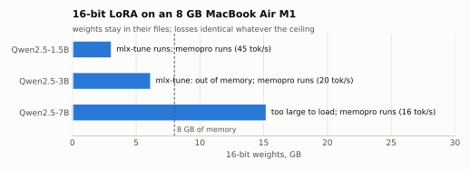
</picture>

<picture>
  <source media="(prefers-color-scheme: dark)" srcset="docs/images/extreme-14b-t4-dark.svg">
  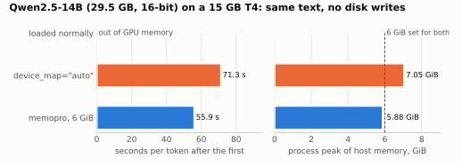
</picture>
<p align="right"><a href="#목차">↑ 목차로</a></p>

## 주요 기능

| 기능 | 설명 |
|---|---|
| 메모리보다 큰 LLM 미세조정 | `memopro.finetune`: 16비트 가중치를 바꾸지 않고 LoRA 학습. 상한에 맞는 batch를 자동으로 고를 수 있음 |
| 메모리보다 큰 LLM 생성 | `memopro.generate`: 모델을 그냥 올렸을 때와 같은 출력. 같은 계열의 작은 초안 모델로 속도 향상 |
| 큰 비전 모델 추론 | `stream_model`: DINOv2, ConvNeXtV2, CLIP·SigLIP 비전 부분 등 Hugging Face 모델을 메모리보다 커도 실행 |
| 다른 도구의 모델 감싸기 | Unsloth·Transformers로 불러온 모델, `mlx_lm.load`로 불러온 모델을 그대로 받아 그 도구의 방식으로 학습·생성하고, memopro는 상한만 맡음 |
| 코드 수정 없는 메모리 상한 | `memopro run --budget 8GB script.py`: NumPy·PyTorch 스크립트를 고치지 않고 상한 안에서 실행 |
| 프로세스 메모리 상한 API | `memopro.enable(budget=...)` 한 줄로 프로세스 전체에 상한 적용 |
| 실행 전 진단과 예측 | `memopro doctor`, `Session.estimate()`: 상한이 들어가는지, 얼마나 느려질지 미리 계산 |
| 메모리보다 큰 CSV 정렬·병합 | `memopro.sort` / `memopro.join`: 중간 파일을 디스크에 쓰지 않고 상한 안에서 |
| 예산 런타임 | 큰 배열·텐서·모듈·옵티마이저를 상한 안에서 관리하는 Python·Rust·C API. `locked=True`로 실시간 버퍼를 RAM에 고정 |
| 스왑 위험 경고 | 상한이 지금 비어 있는 메모리보다 크면 다른 프로그램이 스왑될 수 있다고 시작 시 경고 |
<p align="right"><a href="#목차">↑ 목차로</a></p>

## 보장 사항과 다섯 가지 원칙

> **memopro가 보장하는 것**
>
> 1. **결과 불변**: 생성·추론 출력은 메모리를 충분히 쓴 일반 실행과 비트 단위로 같습니다. 학습 손실은 상한과 관계없이 비트 단위로 같습니다. 다만 일반 PyTorch 학습과는 계산 순서 차이로 마지막 자리가 다를 수 있습니다.
> 2. **메모리 상한**: 프로세스 전체가 상한 안에서 실행됩니다. 지킬 수 없는 상한은 시작 전에 `BudgetExceeded`로 거절하고, 어느 상한이면 되는지 함께 알려 줍니다.
> 3. **디스크 쓰기 최소화**: 실행 중에 스왑 파일·임시 파일·변환한 가중치를 쓰지 않습니다. 디스크에 쓰는 것은 모델을 처음 한 번 내려받을 때뿐이고, 그 양을 알려 줍니다(`download="never"`로 끌 수 있음).

> **설계를 이끄는 다섯 가지 원칙**
>
> 1. **SSD 쓰기 최소**: 처음 내려받는 모델·라이브러리·데이터를 빼면, memopro가 만든 것은 무엇이든 GB 단위로 디스크에 쓰지 않습니다. 메모리를 넘쳐 일으키는 스왑도 여기에 포함됩니다.
> 2. **사용자가 정한 상한**: 상한은 하드웨어 안에서 사용자가 원하는 대로 정합니다. 128GB 기계에서 6GB를 줘도 됩니다. 기본값은 기계 메모리의 80%이고, 정한 상한은 지켜집니다.
> 3. **작고 직관적인 API**: 진입점과 설정을 적게 둡니다. 복잡한 옵션 조합을 만들지 않습니다.
> 4. **사용자 원본과 비트 동일**: memopro를 적용해도 결과와 품질이 바뀌지 않습니다. 사용자가 내려받은 양자화 모델은 그 자체가 원본이고, 그대로 재현합니다. 손실 모드는 없습니다.
> 5. **속도를 위한 연구**: 결과를 바꾸지 않는 범위에서 더 빠르게 만들기 위해 새 알고리즘·구조·커널을 연구합니다.
<p align="right"><a href="#목차">↑ 목차로</a></p>

## 주요 대상

| 분야 | 활용 예 |
|---|---|
| LLM 연구·개발 | 노트북이나 작은 GPU에서 7B~14B급 모델의 16비트 LoRA 학습. 양자화 없는 기준선 실험, 재현성이 필요한 비교 실험 |
| 비전·멀티모달 | 큰 비전 인코더로 특징 추출·분류 추론 |
| 데이터 과학 | RAM보다 큰 NumPy 배열, scikit-learn 전처리 스크립트를 수정 없이 실행. 메모리보다 큰 CSV 정렬·병합 |
| 교육·개인 학습 | 8GB 노트북, 무료 클라우드 GPU처럼 메모리가 작은 환경에서 큰 모델 실습 |
| 실시간·시스템 개발 | 오디오처럼 기다리면 안 되는 버퍼를 RAM에 고정. Rust·C 프로그램에 상한을 지키는 버퍼 런타임 내장 |
<p align="right"><a href="#목차">↑ 목차로</a></p>

## 다른 도구와의 관계

memopro는 "들어가지 않는 크기를, 결과를 바꾸지 않고, 상한 안에서" 실행하는 데 집중합니다. 아래 경우에는 다른 도구가 더 적합합니다.

| 상황 | 더 적합한 도구 | 이유 |
|---|---|---|
| 모델이 GPU·메모리에 다 들어감 | Unsloth, mlx-tune, 일반 PyTorch | 모두 메모리에 두고 전용 커널로 계산하므로 훨씬 빠름(T4 3B: Unsloth가 약 11배, M1 1.5B: mlx-tune이 2.6배) |
| 정확도 손실을 받아들일 수 있음 | QLoRA, llama.cpp(4비트) | 가중치가 작아 읽을 양이 적으므로 빠름 |
| 여러 GPU·여러 기계 | DeepSpeed ZeRO, FSDP | 분산 학습용 |
| 데이터프레임 무작위 접근 | DuckDB, Polars(스트리밍) | 열 단위 엔진이 무작위 접근에 맞게 설계됨 |

다른 도구와 함께 쓸 수도 있습니다. 사용자가 이미 쓰는 도구로 불러온 모델을 넘기면, memopro는 그 도구의 결과를 바꾸지 않고 상한만 맡습니다.

| 함께 쓰는 도구 | memopro에 넘기는 것 | memopro가 하는 일 |
|---|---|---|
| Unsloth (`FastLanguageModel`) | 불러온 모델과 `tokenizer=` | Unsloth의 LoRA 층과 속도로 학습하고, 프로세스 상한을 확인 |
| Transformers | 불러온 모델이나 모델 이름 | 이름이면 가중치를 파일에 둔 채 흘려 쓰기(streaming). 모델이면 그대로 학습·생성 |
| mlx-lm (`mlx_lm.load`) | 불러온 모델과 `tokenizer=` | mlx-lm의 LoRA 층·손실로 학습하고, 상한에 맞지 않는 층만 파일에서 다시 읽음. 결과는 mlx-lm 학습과 같음 |
| 양자화 모델 (bitsandbytes 등) | `memopro.load(..., quantization_config=...)` | 사용자가 준 설정 그대로 불러오기. 그 모델이 원본이 됨 |

<p align="right"><a href="#목차">↑ 목차로</a></p>

---

# Phase 2. 시작하기

## 플랫폼 지원

| 플랫폼 | 지원 범위 | 비고 |
|---|---|---|
| macOS, Apple silicon (M1 이상) | 전체 기능 | Apple GPU(MPS)에 복사 없는 Metal 버퍼로 가중치 전달 |
| Linux x86_64·aarch64 + NVIDIA GPU | 전체 기능 | CUDA. GPU 캐시와 다음 층 미리 복사 |
| Linux CPU | GPU 기능을 뺀 전체 기능 | `memopro run`의 투명 페이징은 userfaultfd 사용 |
| Windows x86_64 | CPU 기능 (LLM 학습·생성, `sort`/`join`, 런타임) | `memopro run`의 투명 페이징과 `locked=True`는 미지원 |

측정에 쓴 환경은 8GB MacBook Air M1, Colab T4(GPU 15GB, RAM 12.7GB), GitHub Actions Linux 러너입니다. Windows는 CI에서 시험합니다. 설계는 메모리 크기에 의존하지 않습니다.
<p align="right"><a href="#목차">↑ 목차로</a></p>

## 요구 사항

| 항목 | 요구 사항 |
|---|---|
| Python | 3.11 이상 (3.11, 3.12, 3.14에서 CI 시험) |
| PyTorch | 2.4 이상 (`finetune`·`generate`·`stream_model` 등 AI 기능) |
| Transformers·PEFT | `memopro[llm]`이 설치 (LLM 학습·생성) |
| Rust | 1.85 이상 (wheel이 없는 환경에서 소스 빌드할 때, Rust 크레이트를 쓸 때) |
| 메모리 | 제한 없음. 상한은 기계 메모리 안에서 사용자가 정함 |
| 디스크 | 모델을 처음 내려받을 공간(예: 7B 16비트는 15.2GB). 실행 중에는 쓰지 않음 |
| GPU | 선택 사항. Apple silicon GPU 또는 NVIDIA CUDA GPU(T4에서 검증) |
<p align="right"><a href="#목차">↑ 목차로</a></p>

## 설치

**Python**

```bash
pip install memopro            # 런타임, memopro run, enable, sort/join, 진단
pip install "memopro[llm]"     # + finetune, generate (PyTorch, Transformers, PEFT)
```

| 추가 옵션 | 포함 |
|---|---|
| `memopro[numpy]` | NumPy |
| `memopro[torch]` | PyTorch, NumPy |
| `memopro[hf]` | PyTorch, Transformers, Accelerate, safetensors |
| `memopro[llm]` | `hf` + PEFT, torchao |
| `memopro[mlx]` | MLX, mlx-lm (Apple silicon) |

PyPI는 macOS arm64, Linux x86_64·aarch64, Windows x86_64 wheel을 제공합니다. 그 밖의 환경에서는 Rust 툴체인으로 소스에서 빌드됩니다.

**Rust**

```bash
cargo add memopro
```

**C**

```bash
git clone https://github.com/imhyensuk/memopro.git && cd memopro
cargo build -p memopro-c --release
# 헤더: crates/memopro-c/include/memopro.h
# 라이브러리: target/release/libmemopro_c.{so,dylib,a}
```
<p align="right"><a href="#목차">↑ 목차로</a></p>

## 빠른 시작

### 1. 언어 모델 학습과 생성 (Python)

처음 실행할 때 Hugging Face에서 공개 모델 Qwen2.5-0.5B(약 1GB)를 한 번 내려받습니다. 토큰은 필요 없고, 이후 실행은 캐시를 읽습니다. 장치는 NVIDIA GPU → Apple GPU → CPU 순서로 자동 선택됩니다. Apple silicon 맥에서 약 1~2분이 걸립니다.

```python
import memopro

texts = [
    "memopro runs models that are larger than the memory of the machine.",
    "It reads each layer's weights from the file only while that layer runs.",
] * 8

r = memopro.finetune("Qwen/Qwen2.5-0.5B-Instruct", texts, budget="1GiB", seq_len=64)
print("losses:", [round(x, 3) for x in r.losses])
print(memopro.generate(r.model, "What does memopro do?", max_new_tokens=30))
r.adapter.save_pretrained("my-lora")  # 표준 PEFT 어댑터
```

상한보다 큰 모델도 같은 코드로 학습합니다. 모델 이름과 상한만 바꾸면 됩니다. 예를 들어 8GB 맥에서 `"Qwen/Qwen2.5-7B-Instruct"`, `budget="4GiB"`로 실행할 수 있습니다.

### 2. 기존 스크립트를 상한 안에서 실행 (Bash)

아래 스크립트는 보통 약 2.4GB를 씁니다(macOS 측정). 코드를 고치지 않고 memopro로 실행하면 1GB 안에서 같은 결과를 냅니다. macOS 또는 Linux와 NumPy가 필요합니다.

```python
# big_job.py: an ordinary NumPy program, no memopro code in it
import numpy as np

x = (np.arange(200_000_000, dtype=np.float32) % 1000) / 1000
y = np.sqrt(x) * 2
print("sum:", float(y.sum(dtype=np.float64)))
```

```bash
python big_job.py                          # 최대 약 2.4GB
memopro run --budget 1GB big_job.py        # 최대 약 1GB, 같은 결과
```

### 3. 코드 안에서 상한 걸기 (Python)

```python
import memopro

s = memopro.enable(budget="8GB")      # 이 프로세스 전체를 8GB 안에서
# ... 평소의 NumPy / PyTorch 코드 ...
print(s.measured())                   # 실제 시간, 최대 메모리, 초과량
memopro.disable()
```

### 4. 메모리 확인 (Bash)

```bash
memopro doctor             # 장치·RAM·디스크별 메모리와 기본 상한
memopro doctor --json      # 기계가 읽는 형식
```

### 5. Rust에서 런타임 쓰기

```rust
use memopro::rt::{Config, Runtime};

let rt = Runtime::new(Config::new(256 << 20))?;   // 버퍼 상한 256 MiB
let id = rt.alloc(64 << 20, 4)?;                  // float32 크기 요소 64 MiB
rt.pin(id, true)?.as_mut_slice()?.fill(0);        // 고정(pin)한 동안만 메모리에 있음
println!("{:?}", rt.stats());                     // 유지·압축·다시 읽기 통계
```

### 6. C에서 런타임 쓰기

```c
#include "memopro.h"

mp_config cfg;
mp_config_default(&cfg, (uint64_t)2 << 30);          /* 2 GiB */
mp_runtime *rt;
mp_runtime_new(&cfg, &rt);
mp_buffer b;
mp_add_file(rt, "big.bin", 0, n, sizeof(float), &b);  /* 파일 영역: 필요하면 다시 읽음 */
mp_pin *p;
mp_pin_acquire(rt, b, 0, &p);
const float *x = (const float *)mp_pin_data(p);       /* mp_unpin 전까지 유효 */
/* ... */
mp_unpin(p);
mp_runtime_free(rt);
```

<p align="right"><a href="#목차">↑ 목차로</a></p>

---

# Phase 3. 상세 명세

## 예산 형식과 설정

상한(budget)은 모든 함수의 `budget=`, 명령줄의 `--budget`, 설정 파일 `memopro.toml`(또는 `$MEMOPRO_CONFIG`), 환경 변수 `MEMOPRO_BUDGET`에서 같은 형식을 씁니다.

| 형식 | 의미 |
|---|---|
| `"auto"` | 이 기계 메모리의 80% (컨테이너 한도가 있으면 그 80%). 기본값 |
| `"6GB"`, `"4GiB"` | 그 크기 그대로. 128GB 기계에서도, 16GB 기계에서도 그대로 상한이 됨 |
| `"50%"`, `0.5` | 이 기계 메모리의 절반 |
| `"device=8GB,host=24GB"` 또는 `{"device": "8GB", "host": "24GB"}` | NVIDIA GPU 메모리와 RAM을 따로 지정 (Apple silicon은 하나로 공유) |

정한 값이 지금 비어 있는 메모리보다 크면 상한은 그대로 둡니다. 대신 다른 프로그램이 스왑으로 밀려날 수 있다고 알려 줍니다. 0.1.x의 `"-2GB"`, `"2GB..6GB"`, `"6GB!"`, `budget_basis`, `headroom`은 0.2.0에서 빠졌고, 쓰면 새 표기를 알려 주는 오류가 납니다.

**설정 항목**

| 설정 | 값 | 기본값 | 의미 |
|---|---|---|---|
| `budget` | 위 형식 | `"auto"` | 메모리 상한 |
| `download` | `"auto"`, `"never"` | `"auto"` | 디스크에 없는 모델을 한 번 내려받을지 |
| `fallback` | `"stream"`, `"none"` | `"stream"` | `load`에서 모델이 상한에 안 들어갈 때 흘려 쓰기로 불러올지 |
| `over_ceiling` | `"error"`, `"allow"` | `"error"` | 저장해 둔 활성값을 되돌릴 자리가 없을 때 멈출지, 상한을 넘겨 경고하고 되돌릴지 |
| `model_dirs` | 폴더 목록 | 없음 | 초안 모델을 찾을 폴더 |

**설정 우선순위** (뒤가 앞을 덮어씀): 기본값 < `memopro.toml`/`$MEMOPRO_CONFIG` < `MEMOPRO_<이름>` 환경 변수 < `memopro.configure()` < `with memopro.using(...)` 블록 < 함수 호출 인자

```toml
# memopro.toml
budget = "6GB"
download = "never"
model_dirs = ["~/models", "/Volumes/SSD/llm"]
```

```python
memopro.configure(budget="6GB", download="never")
with memopro.using(budget="2GB"):
    memopro.generate("Qwen/Qwen2.5-1.5B-Instruct", "Hello")
```
<p align="right"><a href="#목차">↑ 목차로</a></p>

## 명령줄 (CLI)

```bash
memopro doctor [--json] [--no-devices] [--budget BUDGET]
memopro run [--budget BUDGET] [--dry-run] [--report-json PATH] [--no-numpy] [--no-torch] script.py [인자...]
memopro --version
```

| 명령·옵션 | 설명 |
|---|---|
| `memopro doctor` | 장치(GPU)·호스트(RAM)·디스크별 메모리와 상한 보고 |
| `doctor --json` | 기계가 읽는 형식으로 출력 |
| `doctor --no-devices` | GPU를 찾지 않음 (torch를 불러오지 않음) |
| `memopro run script.py` | 스크립트를 고치지 않고 상한 안에서 실행 |
| `run --budget` | 프로세스 전체 상한 |
| `run --dry-run` | 무엇을 할지 보여 주고 실행하지 않음 |
| `run --report-json PATH` | 끝날 때 결과 보고서를 JSON으로 저장 |
| `run --no-numpy` / `--no-torch` | NumPy 배열 페이징 / PyTorch 활성값 이동을 끔 |
| `run --keep-malloc-cache` | macOS: `MallocLargeCache=0`으로 다시 시작하지 않음 |
| `run --keep-mps-heap` | Apple silicon: MPS 메모리 설정으로 다시 시작하지 않음 |

종료 코드는 0(성공), 1(memopro 오류), 2(사용법 오류), 3(구현되지 않음)입니다.
<p align="right"><a href="#목차">↑ 목차로</a></p>

## Python·Rust·C API

**Python** (`import memopro`)

| 함수 | 설명 |
|---|---|
| `finetune(model, texts, *, tokenizer=None, budget="auto", device="auto", epochs=1, seq_len=512, batch=1, lr=2e-4, rank=8, alpha=16, targets=("q_proj","k_proj","v_proj","o_proj"), seed=0, checkpointing=True)` | 메모리보다 큰 LLM의 LoRA 학습. `FinetuneResult`(`model`, `adapter`, `losses`, `step_seconds`, `seconds`, `tokens`, `held_back`, `batch`) 반환. `batch="auto"`는 상한에 맞는 가장 큰 batch를 고름. Unsloth·Transformers 모델이나 `mlx_lm.load` 모델을 `tokenizer=`와 함께 넘길 수 있음 |
| `generate(model, prompt, *, tokenizer=None, budget="auto", device="auto", draft="auto", max_new_tokens=256, chat=True, streamer=None, stopping_criteria=None)` | 메모리보다 큰 LLM의 생성. 출력은 일반 greedy 생성과 같음. `draft`는 초안 모델(이름·폴더·모델, `None`이면 쓰지 않음). `streamer`·`stopping_criteria`는 `model.generate`에 그대로 전달 |
| `load(model_id, *, budget=..., fallback=..., **from_pretrained)` | Hugging Face 모델을 저장된 그대로(정밀도를 바꾸지 않고) 불러오기. 상한에 안 들어가면 흘려 쓰기로 불러옴. `dtype=`·`quantization_config=`를 주면 그것이 원본 |
| `enable(budget=None, *, numpy=True, torch=True, transformers=True, **settings)` / `disable()` | 프로세스 전체 메모리 상한. `Session`(`estimate()`, `measured()`, `summary()`) 반환 |
| `sort(path, key, *, out, budget="auto")` | 메모리보다 큰 CSV를 한 열로 정렬. `out`은 파일 경로나 바이트 조각을 받는 함수 |
| `join(left, right, on, *, out, budget="auto")` | 메모리보다 큰 CSV 두 개를 한 열로 병합 |
| `doctor(*, devices=True)` | CLI `memopro doctor`와 같은 보고 |
| `configure(**settings)` / `using(**settings)` / `get_config()` | 전역 설정 / `with` 블록 설정 / 현재 설정 |
| `report()` | 프로세스 전체 보고서 |
| 오류 | 모두 `MemoproError`를 상속: `BudgetExceeded`(`.suggestions`), `IntegrityError`, `InvalidArgument`, `ModeUnavailable`, `ConfigError`, `PolicyError`, `NotYetImplemented` |

**Rust** (`memopro` 크레이트, [docs.rs](https://docs.rs/memopro))

| 항목 | 설명 |
|---|---|
| `rt::Runtime::new(Config)` | 상한 안에서 버퍼를 관리하는 런타임. `Config::new(budget)`; 필드 `compress_level`, `min_saving`, `policy`, `prefetch`, `lookahead`, `process_budget` |
| `Runtime::alloc(nbytes, elem)` / `alloc_locked(...)` | 새 버퍼 / RAM에 고정한 버퍼 |
| `Runtime::add_file(path, offset, nbytes, elem, ...)` | 파일 영역 등록. 메모리가 모자라면 비우고 다시 읽음(해시 검증) |
| `Runtime::derive(inputs, nbytes, ...)` | 다른 버퍼에서 계산되는 버퍼. 비우면 다시 계산하고 처음 결과와 대조 |
| `Runtime::pin(id, write)` → `Pin` | 고정한 동안 같은 주소에 머무는 버퍼(`as_slice`, `as_mut_slice`) |
| `prefetch`, `evict`, `free`, `state`, `nbytes`, `read_into` | 버퍼 단위 제어와 상태(`BufferState`: `Resident`, `Compressed`, `Dropped`, `Unloaded`) |
| `Runtime::stats()` / `predict()` | 유지·압축·다시 읽기 통계 / 한 주기 기록으로 예상 추가 시간 |
| `rt::pager::Pager` (Linux, macOS) | 코드를 고치지 않은 프로그램의 익명 메모리를 메모리 안에서 압축하는 투명 페이징 |
| `rt::process_footprint()` | 현재 프로세스 메모리 사용량 |
| `csv`, `codec`, `edr`, `hwinfo`, `verify` | CSV 커널, 무손실 압축(byte shuffle + zstd, bf16용 EDR), 기기 메모리 정보, 원본 대조 |

**C** (`memopro-c`, `crates/memopro-c/include/memopro.h`)

| 함수 | 설명 |
|---|---|
| `mp_config_default`, `mp_runtime_new`, `mp_runtime_free`, `mp_limit` | 런타임 만들기·해제, 현재 한도 |
| `mp_alloc`, `mp_add_file`, `mp_derive`, `mp_free` | 버퍼 등록과 해제 |
| `mp_pin_acquire`, `mp_pin_data`, `mp_pin_size`, `mp_unpin` | 버퍼 고정과 접근 |
| `mp_prefetch`, `mp_evict`, `mp_state`, `mp_nbytes` | 버퍼 단위 제어 |
| `mp_stats_get`, `mp_predict` | 통계와 예측 |
| `mp_version`, `mp_abi_version`, `mp_last_error` | 버전과 마지막 오류 |

모든 `int` 반환 함수는 `MP_OK`(0) 또는 음수 오류 코드(`MP_ERR_BUDGET`, `MP_ERR_INTEGRITY` 등)를 돌려줍니다. 모든 함수는 스레드에 안전합니다.
<p align="right"><a href="#목차">↑ 목차로</a></p>

## 런타임 API

Python 런타임(`memopro.rt`)은 큰 배열·텐서를 직접 상한 안에 맡기고 싶을 때 씁니다.

| 이름 | 설명 |
|---|---|
| `Runtime(budget="auto", *, compress_level=1, min_saving=0.15, policy="reuse", prefetch=True, lookahead="64MiB", process_budget=None)` | 상한 안에서 버퍼를 관리하는 런타임 |
| `Runtime.load_npy(path)` / `.add_file(...)` | 파일 원본 버퍼. 필요하면 원본을 다시 읽음(해시 검증) |
| `Runtime.array(shape, dtype, locked=False)` / `.alloc(...)` | 새 버퍼. 쓰지 않는 동안 무손실 압축. `locked=True`는 RAM에 고정(macOS·Linux) |
| `Buffer.view(write=False)` | 사용하는 동안만 메모리에 올라오는 복사 없는 NumPy 뷰 (`with` 블록) |
| `Runtime.derive(...)` | 다른 버퍼에서 계산되는 버퍼 |
| `Runtime.adopt(obj, threshold="1MiB")` | 텐서·모듈·옵티마이저·배열을 담은 객체를 런타임에 맡김. `with h:` 안에서 깨어남 |
| `Runtime.stats()` / `.report()` / `.predict()` / `.limit()` / `.hold_back()` | 통계, 보고서, 예측, 현재 한도, 한도 줄이기 |
| `memopro.rt.torch.stream_model(name, *, budget="auto", device="cpu", model_class=None, revision=None, gpu_budget="auto", prefetch=True, lookahead="64MiB")` | 가중치를 파일에 둔 채 Hugging Face 모델 실행 |
| `memopro.rt.torch.draft_model(name, *, target=None, device="mps")` | 생성 속도용 초안 모델 (Apple GPU: int4, NVIDIA GPU: 16비트) |
| `memopro.rt.torch.generate(model, input_ids, *, draft=None, **kwargs)` | 일반 greedy `generate`와 같은 출력의 초안 검증 생성 |
| `memopro.rt.torch.causal_lm_loss`, `enable_checkpointing`, `saved_weights` | 흘려 쓰는 모델로 직접 학습 루프를 짤 때 쓰는 손실·체크포인트·가중치 참조 도구 |
| `memopro.rt.process_footprint()` / `process_peak_footprint()` | 현재·최대 프로세스 메모리 |
<p align="right"><a href="#목차">↑ 목차로</a></p>

## 고급 사용법

### 학습 속도: `batch="auto"`

```python
r = memopro.finetune("Qwen/Qwen2.5-7B-Instruct", texts, budget="4GiB", batch="auto")
print(r.batch)                           # 고른 batch
```

흘려 쓰는 가중치는 한 단계에 한 번만 읽히므로, batch가 클수록 토큰당 시간이 줄어듭니다. 결과는 같은 batch끼리 상한과 관계없이 같습니다.

### 생성 속도: 초안 모델

```python
text = memopro.generate("Qwen/Qwen2.5-7B-Instruct", "Summarize: ...",
                        budget="2GiB", draft="Qwen/Qwen2.5-1.5B-Instruct")
```

작은 모델이 토큰을 제안하고 큰 모델이 한 번에 검증합니다. 출력은 큰 모델만으로 생성한 결과와 같습니다. 초안은 같은 토크나이저를 쓰는 모델이어야 합니다.

`draft="auto"`(기본값)는 디스크에 이미 있는 모델 가운데 같은 토크나이저를 쓰고 크기가 약 1/5인 모델을 찾아 씁니다. 찾는 곳은 다음 세 군데입니다.

1. `model_dirs` 설정에 적은 폴더
2. 폴더에서 불러온 모델이라면 그 옆 폴더들
3. Hugging Face 캐시

알맞은 모델이 없고 모델을 토큰마다 흘려 읽어야 한다면(Apple GPU), 모델 자신의 int4 사본을 메모리에만 만들어 초안으로 씁니다. 디스크에는 쓰지 않고, 출력은 같습니다. NVIDIA GPU에서는 초안이 차지하는 GPU 캐시보다 얻는 이득이 클 때만 초안을 씁니다.

### 다른 도구로 불러온 모델

```python
from unsloth import FastLanguageModel
model, tok = FastLanguageModel.from_pretrained("unsloth/Qwen2.5-3B-Instruct", load_in_4bit=False)
r = memopro.finetune(model, texts, tokenizer=tok, seq_len=512)   # Unsloth의 LoRA 층과 속도 + 프로세스 상한 확인
```

```python
import mlx_lm
model, tok = mlx_lm.load("Qwen/Qwen2.5-3B-Instruct")
r = memopro.finetune(model, texts, tokenizer=tok, budget="2.5GiB")  # mlx-lm 학습과 같은 결과
print(memopro.generate(model, "Hello", tokenizer=tok, budget="2.5GiB"))
```

### 비전 모델

```python
import transformers
import memopro.rt.torch as rtt

m = rtt.stream_model("facebook/dinov2-giant", budget="1GB", device="cuda",  # "mps", "cpu"
                     model_class=transformers.Dinov2Model)
features = m(pixel_values=images).pooler_output
```

`model_class=transformers.SiglipVisionModel`처럼 CLIP·SigLIP 체크포인트의 비전 부분만 실행할 수도 있습니다.

### 실행 전 예측

```python
s = memopro.enable(budget="8GB")
print(s.estimate(sample, total="12GB", passes=3))   # 실행 전: 상한에 맞는지, 예상 추가 시간
...                                                 # NumPy / PyTorch 코드
print(s.measured())                                 # 실행 후: 실제 시간, 최대 메모리, 초과량
```

`estimate`는 표본 데이터로 압축 비율과 속도를 재어, 전체 작업이 상한 안에서 몇 초 더 걸릴지 계산합니다.

### 런타임에 직접 맡기기

```python
from memopro.rt import Runtime

rt = Runtime(budget="2GB")
big = rt.load_npy("big.npy")                 # 파일 원본: 필요하면 다시 읽음(해시 검증)
work = rt.array((50_000, 4_096), "float32")  # 새 버퍼: 쓰지 않는 동안 무손실 압축
with work.view(write=True) as a:             # 사용하는 동안만 메모리에 올라오는 NumPy 뷰
    a[:] = 1.0

h = rt.adopt(model)          # 이미 만든 모델(텐서·모듈·옵티마이저·배열)을 통째로 맡기기
with h:                      # 블록 안에서만 깨어남; 쓰지 않는 동안은 무손실 압축
    out = model(x)
```

### 메모리보다 큰 CSV 정렬·병합

```python
import hashlib, memopro

memopro.sort("events.csv", key="user_id", out="sorted.csv", budget="8GB")

h = hashlib.sha256()  # 출력을 파일 대신 함수로 받기
memopro.join("events.csv", "users.csv", on="user_id", out=h.update, budget="8GB")
```

중간 파일을 쓰지 않고, 필요한 만큼 원본을 다시 읽습니다. 블록마다 첫 읽기의 CRC와 대조하므로, 도중에 파일이 바뀌면 틀린 결과 대신 오류가 납니다. 한 번에 담은 행은 상한에 닿으면 무손실 압축됩니다.

- **입력 형식**: RFC 4180 CSV를 받습니다. 머리글이 있어야 하고, `,`로 구분하며, 쉼표·줄바꿈·`""`를 담은 따옴표 필드와 `\n`·`\r\n` 줄 끝을 처리합니다.
- **열쇠 비교**: 파일의 모든 값이 정수면 숫자로 비교하고, 아니면 바이트 순서(`LC_ALL=C sort`와 같음)로 비교합니다.

### 실시간 버퍼 고정

```python
from memopro.rt import Runtime

rt = Runtime(budget="1GB")
samples = rt.array((48_000 * 60,), "int16", locked=True)  # 압축·스왑되지 않음
```

### Apple GPU 메모리 설정

Apple GPU에서는 `finetune`·`stream_model`을 다른 MPS 연산보다 먼저 호출해야 합니다. 그래야 memopro가 PyTorch MPS 할당기의 여유 힙(약 1GiB)을 줄이는 설정을 적용할 수 있습니다. `memopro run`은 이 설정을 자동으로 적용해 스크립트를 다시 시작합니다.
<p align="right"><a href="#목차">↑ 목차로</a></p>

## 예제 디렉터리

| 경로 | 내용 |
|---|---|
| [`examples/quickstart.ipynb`](examples/quickstart.ipynb) | 5분 안내. CPU에서 1분 안에 돌고 아무것도 내려받지 않음 |
| [`examples/colab_extreme_14b.ipynb`](examples/colab_extreme_14b.ipynb) | Colab T4에서 들어가지 않는 14B 모델: 그냥 올리기, `device_map="auto"`, memopro 비교 |
| [`examples/colab_t4_suite_*.ipynb`](examples/) | Colab T4 통합 시험: 언어 모델, 비전, 속도(GPU 캐시), 데이터 프로그램 |
| [`examples/colab_t4_unsloth.ipynb`](examples/colab_t4_unsloth.ipynb), [`colab_t4_beat.ipynb`](examples/colab_t4_beat.ipynb), [`colab_unsloth_bits.ipynb`](examples/colab_unsloth_bits.ipynb) | Unsloth와 같은 16비트 LoRA 비교, Unsloth가 못 돌리는 크기, 비트 차이 분석 |
| [`examples/colab_model_families.ipynb`](examples/colab_model_families.ipynb) | 여러 모델 계열의 생성·학습이 일반 실행과 같은지 시험 |
| [`examples/colab_e069.ipynb`](examples/colab_e069.ipynb) | 30GB CSV를 8GB 상한에서 정렬·병합 |
| [`examples/colab_windows_local.ipynb`](examples/colab_windows_local.ipynb) | Windows PC(CPU)에서 한계 시험과 비교 |
| [`examples/colab_t4/`](examples/colab_t4/), [`examples/windows_local/`](examples/windows_local/) | 위 노트북을 만드는 원본 스크립트(`build.py`로 생성) |
| [`experiments/`](experiments/) | 측정 스크립트. 결과는 `docs/research/data/<실험>/`에 저장 |
| [`docs/guide/`](docs/guide/README.md) | 사용 안내서 (설치부터 동작 방식까지) |

Colab 노트북은 결과를 Google Drive에 저장하고, 끊겼다가 다시 실행하면 이어서 잽니다.
<p align="right"><a href="#목차">↑ 목차로</a></p>

## 0.1.x에서 바뀐 API

**빠진 것** (쓰면 무엇으로 바꿀지 알려 주는 오류가 납니다)

| 빠진 이름 | 대신 쓸 것 |
|---|---|
| `check`, `train_session`, `optimize` | `finetune`, 또는 `memopro.enable()` 안에서 평소 코드 |
| `hibernate`, `census`, `elastic`, 기법 등록 API, 노트북 매직 | `Runtime.adopt`, `memopro.enable()` |
| CLI `memopro check` | `memopro doctor`, `memopro run --dry-run` |
| 디스크에 쓰는 기능 (spill, 파일 상주, 디스크 오프로드, `fallback="stored"`, `disk_writes` 등) | 없음 (memopro는 내려받기 말고는 디스크에 쓰지 않음) |
| 자동 손실 선택 (`quality`, `prefer`) | 없음 (int4·int8·half를 대신 고르지 않음. 사용자가 준 정밀도가 원본) |
| 예산 형식 `"-2GB"`, `"2GB..6GB"`, `"6GB!"`, `{use, min, max}`, `budget_basis`, `headroom` | `"auto"`, `"6GB"`, `"50%"`, `"device=…,host=…"` |

**추가된 것**

| 이름 | 내용 |
|---|---|
| `finetune`, `generate` | 메모리보다 큰 LLM의 학습·생성 (Unsloth·Transformers·mlx-lm 모델 포함) |
| `enable` / `disable` | 프로세스 전체 상한 |
| `sort` / `join` | 메모리보다 큰 CSV |
| `Runtime.adopt`, `alloc(..., locked=True)` | 객체 맡기기, 실시간 버퍼 고정 |
| `memopro run` | 코드 수정 없는 상한 실행 (Linux, macOS) |
| Windows wheel | CPU 기능 |

<p align="right"><a href="#목차">↑ 목차로</a></p>

---

# Phase 4. 성능과 내부 구조

## 벤치마크

### 8GB Mac에서 7B 학습의 메모리 변화

<picture>
  <source media="(prefers-color-scheme: dark)" srcset="docs/images/train-7b-8gb-dark.svg">
  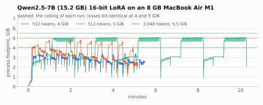
</picture>

15.2GB 모델을 8GB 기계에서 학습하는 동안, 프로세스 메모리는 매 단계 가중치를 읽고 비우며 오르내리고 상한(점선)을 넘지 않습니다. 2,048토큰 학습은 주의(attention) 점수 때문에 역전파 구간에서 상한 가까이 머뭅니다.

| 경우 | 상한 | 단계 시간 | 토큰/초 | 최대 메모리 | 손실 |
|---|---|---|---|---|---|
| 512토큰 × 10단계 | 4 GiB | 31.5초 | 16.3 | 3.55 GiB | 5GiB와 비트 동일 |
| 512토큰 × 10단계 | 5 GiB | 29.6초 | 17.3 | 4.86 GiB | 4GiB와 비트 동일 |
| 2,048토큰 × 5단계 | 5.5 GiB | 121.4초 | 16.9 | 5.06 GiB | 완주 |

### 8GB Mac에서 메모리보다 큰 생성

<picture>
  <source media="(prefers-color-scheme: dark)" srcset="docs/images/generation-8gb-dark.svg">
  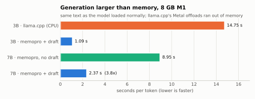
</picture>

출력은 모델을 그냥 올렸을 때와 같습니다. llama.cpp는 Metal로 올리면 모두 메모리 부족이었고 CPU로만 돌았습니다.

### 프로세스 전체가 상한 안에

<picture>
  <source media="(prefers-color-scheme: dark)" srcset="docs/images/ceiling-dark.svg">
  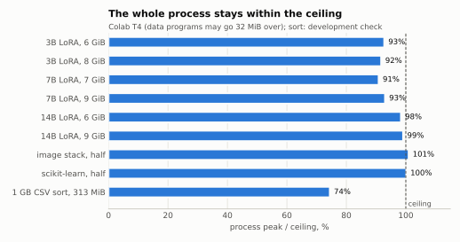
</picture>

| 작업 (환경) | 상한 | 최대 메모리 |
|---|---|---|
| 3B 16비트 LoRA (Colab T4) | 6 / 8 GiB | 5.56 / 7.34 GiB |
| 7B 16비트 LoRA (Colab T4, 7B는 T4에 그냥 안 들어감) | 7 / 9 GiB | 6.36 / 8.37 GiB |
| 14B 16비트 LoRA (Colab T4, 29.5GB 모델) | 6 / 9 GiB | 5.90 / 8.92 GiB |
| 영상 묶음, 메모리 절반 (Colab) | 403 MiB | 407 MiB (허용 +32 MiB 안) |
| scikit-learn, 메모리 절반 (Colab) | 1,220 MiB | 1,222 MiB |
| 1GB CSV 정렬 (M1, 개발 확인) | 313 MiB | 233 MiB |

### 메모리 절반에서 그대로 실행, SSD에는 0바이트

<picture>
  <source media="(prefers-color-scheme: dark)" srcset="docs/images/half-memory-dark.svg">
  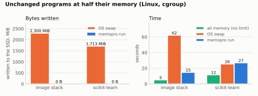
</picture>

| 작업 | SSD 쓰기: OS 스왑 / memopro | 시간: 메모리 전부 / OS 스왑 / memopro |
|---|---|---|
| 영상 묶음 | 2,300 MiB / 0 | 5.3 / 62.2 / 14.8초 |
| scikit-learn 분류 | 1,713 MiB / 0 | 11.7 / 25.5 / 27.0초 |

Linux 러너에서 cgroup 상한을 일반 실행 최대 메모리의 1/2로 두고 쟀습니다.

### 실시간 오디오: 다른 메모리가 스왑돼도 끊기지 않음

<picture>
  <source media="(prefers-color-scheme: dark)" srcset="docs/images/audio-locked-dark.svg">
  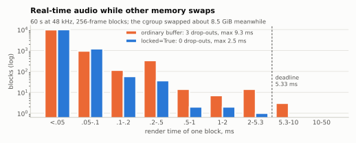
</picture>

| 경우 | 끊김 | 렌더 p99 / 최대 | 메이저 폴트 |
|---|---|---|---|
| 압박 없음, 일반 버퍼 | 0 | 0.06 / 0.24 ms | 0 |
| 압박 있음, 일반 버퍼 | 3 | 0.30 / 9.34 ms | 549 |
| 압박 있음, `locked=True` | 0 | 0.09 / 2.53 ms | 75 (Python 자체 코드 페이지) |

### 무손실 압축의 비율과 속도

<picture>
  <source media="(prefers-color-scheme: dark)" srcset="docs/images/compression-dark.svg">
  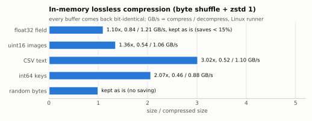
</picture>

거의 줄지 않는 자료(15% 미만 절약)는 압축하지 않고 그대로 둡니다. 모든 버퍼가 비트 단위로 같게 돌아왔습니다. Apple M1에서는 비율이 같고 속도는 약 두 배였습니다(CSV 압축 0.98GB/s, 해제 3.23GB/s).

### 다른 언어에서 부르기

<picture>
  <source media="(prefers-color-scheme: dark)" srcset="docs/images/ffi-dark.svg">
  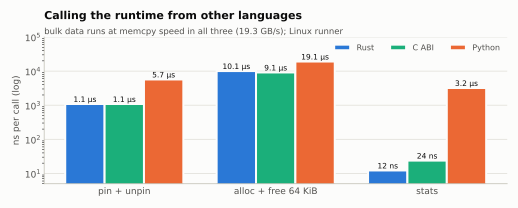
</picture>

### 전체 표

| 작업 | 환경 | 결과 |
|---|---|---|
| Qwen2.5-14B 생성 (29.5GB) | NVIDIA T4, 15GB | 상한 6GiB에서 첫 토큰 이후 55.9초/토큰, 최대 5.88GiB, 디스크 쓰기 0. `device_map="auto"`는 71.3초/토큰, CPU 6GiB 지정에 최대 7.05GiB. 출력 동일 |
| Qwen2.5-14B LoRA 학습 | NVIDIA T4, 15GB | 상한 6/9GiB에서 512토큰 단계당 190/183초, 손실이 상한과 관계없이 비트 동일 |
| Qwen2.5-7B LoRA 학습 | Apple M1, 8GB | 상한 4~5.5GiB에서 16.3~17.3토큰/초 (512·2,048토큰) |
| Qwen2.5-7B LoRA 학습 | Apple M1, 8GB | 상한 2.5GiB, `batch=4`에서 15.5토큰/초 |
| Mistral-7B LoRA 학습 | NVIDIA T4, 15GB | 상한 4GiB, 약 43토큰/초 |
| Qwen2.5-7B 생성 (초안 사용) | Apple M1, 8GB | 8.95 → 2.37초/토큰, 출력 동일 |
| Qwen2.5-7B 생성 (초안 없음) | NVIDIA T4, 15GB | 첫 토큰 이후 일반 실행의 1.04배(0.066 대 0.064초/토큰), 출력 동일, 최대 2.32GiB(일반 3.58GiB) |
| Qwen2.5-3B LoRA 학습 | Apple M1, 8GB | 20토큰/초 (mlx-tune은 메모리 부족) |
| Qwen2.5-3B LoRA 학습, `mlx_lm.load` 모델 | Apple M1, 8GB | 상한 2.5GiB에서 22.8토큰/초, 손실·어댑터가 mlx-lm 학습과 비트 동일 (mlx-lm 그대로는 1.8토큰/초에 스왑 +0.9GB) |
| 1.5B~3.8B 모델 (Qwen2.5, SmolLM2, Phi-3.5) | NVIDIA T4, 15GB | 메모리를 충분히 쓴 실행 대비 학습 1.00~1.03배, 생성 1.06~1.35배 시간 |
| NumPy·scikit-learn·CSV 처리, 필요 메모리의 50~75% 상한 | Linux | 결과 동일, 1.1~3.4배 시간 |
| 같은 3B LoRA, 모델이 GPU에 들어가는 크기 | NVIDIA T4 | Unsloth 0.45초/단계 대 memopro 5.1초/단계 (Unsloth가 약 11배 빠름) |

**검증한 모델**: Qwen2.5(1.5B~14B), Qwen3, Qwen3.5, Llama 3.2, Gemma 3, Phi-2, Phi-3, Phi-3.5, Granite, SmolLM2, SmolLM3, DeepSeek-R1-Distill(Qwen 구조), Mistral-7B, DINOv2, ConvNeXtV2, ResNet-152. 각 계열에서 생성 글은 일반 실행과 같았고, 학습 손실은 상한과 관계없이 같았습니다.
<p align="right"><a href="#목차">↑ 목차로</a></p>

## 동작 원리

memopro의 핵심은 Rust 런타임입니다. 큰 버퍼마다 "어떻게 되돌릴 수 있는가"를 기록해 두고, 상한에 닿으면 되돌리는 비용이 가장 싼 버퍼부터 메모리에서 내보냅니다.

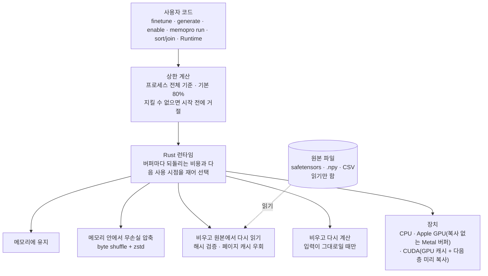

흘려 쓰는 모델에서 한 층이 계산되는 과정은 다음과 같습니다.

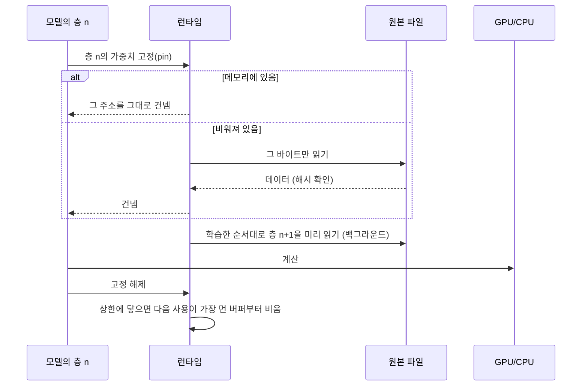

**구성 요소**

- **상한 계산**: 기계 메모리(컨테이너 한도가 있으면 그것)에서 상한을 정하고, 프로세스의 실제 사용량(macOS `phys_footprint`, Linux RSS, Windows 작업 집합)을 재면서 런타임의 몫을 줄입니다.
- **흘려 쓰기 (`stream_model`)**: Hugging Face 모델의 뼈대만 만들고, 가중치는 safetensors 파일의 해당 영역에서 층을 계산할 때만 읽습니다. 순전파 순서를 학습해 다음 층을 미리 읽습니다.
- **장치별 경로**
  - Apple GPU: 런타임 메모리를 복사 없는 Metal 버퍼로 넘깁니다.
  - NVIDIA GPU: 자동 GPU 캐시에 들어가는 만큼 가중치를 두고, 나머지는 별도 스트림에서 다음 층을 미리 복사합니다. 학습할 때는 가장 큰 가중치 하나만큼 캐시를 비워 둡니다.
- **학습 메모리**: 층 단위 체크포인트로 활성값을 줄이고, 첫 단계 전에 활성값을 추정해 상한에 들어가지 않으면 시작 전에 거절합니다.
- **투명 페이징 (`memopro run`)**: 코드를 고치지 않은 프로그램의 큰 메모리를 런타임 영역에 두고, 페이지 폴트로 필요할 때 되돌립니다(Linux userfaultfd, macOS 시그널). 내보낼 때는 압축만 하고 디스크에는 쓰지 않습니다.
- **초안 검증 생성**: 작은 모델이 여러 토큰을 제안하면, 큰 모델이 행 단위로 하나씩 검증해 일반 greedy 생성과 비트 단위로 같은 출력을 냅니다.

## 한계

- **메모리를 크게 넘는 모델은 느립니다.** 실행은 되지만 저장 장치 읽기 속도에 묶입니다. 예를 들어 NVIDIA T4에서 14B는 생성이 토큰당 약 1분, 16비트 LoRA가 약 3토큰/초입니다.
- **모델이 메모리에 들어가는 크기에서는 전용 도구가 훨씬 빠릅니다.** T4 3B에서 Unsloth가 약 11배, M1 1.5B에서 mlx-tune이 2.6배 빨랐습니다. memopro의 장점은 들어가지 않는 크기를, 결과를 바꾸지 않고, 상한 안에서 돌리는 데 있습니다.
- **상한이 비어 있는 메모리보다 크면 다른 프로그램이 스왑될 수 있습니다.** memopro는 상한을 지키지만, 운영체제가 자리를 만들려고 다른 프로그램을 디스크로 밀어낼 수 있습니다. 8GB M1에서 7B를 4~5GiB 상한으로 학습했을 때 시스템 스왑이 0.5~1.2GB 늘었습니다. 이 경우 `finetune`·`generate`가 시작할 때 경고합니다.
- **무작위 접근 데이터 작업은 느리거나 상한을 못 지킬 수 있습니다.** 코드를 고치지 않은 pandas 데이터프레임 조작, Polars 등이 해당합니다. 큰 CSV의 정렬·병합에는 `memopro.sort`/`memopro.join`을 쓰십시오.
- **학습 손실의 기준**: CUDA에서 학습 손실은 상한과 관계없이 같지만, 일반 PyTorch 학습과는 2단계부터 마지막 자리가 다를 수 있습니다.
- **MoE 모델은 지원하지 않습니다.** 전문가 가중치를 합쳐 쓰는 모델(Qwen3-MoE, Qwen3-Next, DeepSeek V2·V4, Kimi Linear, GLM4-MoE, MiniMax M2 등)은 폴더에서 흘려 쓸 수 없고 오류로 거부됩니다.
- **Unsloth와의 비트 동일성은 주장하지 않습니다.** Unsloth 학습은 Unsloth 단독끼리도 실행마다 첫 역전파부터 비트가 다릅니다. T4 3B 측정에서 시작 어댑터와 첫 손실은 같았고, 뒤 손실의 차이(약 0.0005 이내)는 Unsloth 단독끼리의 차이와 구별되지 않았습니다.
- **`locked=True`는 데이터 버퍼만 고정합니다.** 프로그램 코드까지 고정하려면 프로그램이 직접 `mlockall`을 써야 합니다.
- **Windows**에서는 `memopro run`의 투명 페이징과 `locked=True`를 쓸 수 없습니다.

## 자주 묻는 질문과 문제 해결

<details>
<summary><b>memopro를 쓰면 결과가 정말 같습니까?</b></summary>

생성·추론은 메모리를 충분히 쓴 일반 실행과 비트 단위로 같습니다. 이는 시험(`tests/`)과 측정으로 확인합니다. 학습 손실은 상한을 바꿔도 비트 단위로 같습니다. 일반 PyTorch 학습과는 계산 순서 때문에 마지막 자리가 다를 수 있습니다. 4비트처럼 결과를 바꾸는 방식은 memopro가 대신 고르지 않습니다.
</details>

<details>
<summary><b>디스크에 무엇을 씁니까?</b></summary>

처음 실행할 때 모델을 한 번 내려받는 것(Hugging Face 캐시)뿐이고, 그 양을 알려 줍니다. 실행 중에는 스왑 파일·임시 파일·변환한 가중치를 쓰지 않습니다. 내려받기도 막으려면 `memopro.configure(download="never")` 또는 `MEMOPRO_DOWNLOAD=never`를 쓰십시오.
</details>

<details>
<summary><b><code>BudgetExceeded</code> 오류가 납니다.</b></summary>

상한이 작업에 필요한 최소 메모리(가장 큰 가중치 한 개, 한 단계의 활성값, 프로세스 자체의 메모리)보다 작다는 뜻입니다. 오류의 `.suggestions`와 메시지가 실제로 들어가는 상한을 알려 줍니다. 상한을 그만큼 올리거나 `seq_len`·`batch`를 줄이십시오.
</details>

<details>
<summary><b>"the ceiling ... is above the ... free now" 경고가 나옵니다.</b></summary>

정한 상한이 지금 비어 있는 메모리보다 큽니다. memopro는 상한을 지키지만, 운영체제가 다른 프로그램을 스왑으로 밀어낼 수 있습니다. 다른 프로그램을 닫거나 상한을 낮추십시오. `memopro doctor`로 지금 비어 있는 메모리를 볼 수 있습니다.
</details>

<details>
<summary><b>너무 느립니다.</b></summary>

모델이 상한보다 훨씬 크면 매 단계 가중치를 저장 장치에서 다시 읽으므로 느린 것이 정상입니다. 다음을 시도해 보십시오.

- 학습: `batch="auto"`. 한 번 읽은 가중치로 더 많은 토큰을 처리합니다.
- 생성: 같은 계열의 작은 초안 모델(`draft=`).
- 상한을 늘려 메모리에 남는 가중치를 늘리기.
- 모델이 메모리에 다 들어간다면 Unsloth·mlx-tune 같은 전용 도구가 더 빠릅니다.
</details>

<details>
<summary><b>Apple GPU에서 메모리가 예상보다 많이 잡힙니다.</b></summary>

PyTorch의 MPS 할당기는 압박이 없으면 약 1GiB 힙을 따로 잡습니다. `finetune`·`stream_model`을 다른 MPS 연산보다 먼저 호출해야 memopro가 이를 줄이는 설정을 적용할 수 있습니다. `memopro run`은 이 설정으로 스크립트를 다시 시작합니다(`--keep-mps-heap`으로 끌 수 있음).
</details>

<details>
<summary><b>양자화 모델(4비트·8비트)을 써도 됩니까?</b></summary>

됩니다. 사용자가 `memopro.load(..., quantization_config=...)`나 `dtype=`으로 직접 준 설정은 그것이 원본이 되어 그대로 불러옵니다. memopro가 대신 양자화하는 일은 없습니다.
</details>

<details>
<summary><b>MoE 모델이 거부됩니다.</b></summary>

0.2.0은 전문가 가중치를 합쳐 쓰는 MoE 모델의 흘려 쓰기를 지원하지 않습니다. 일반(dense) 모델을 쓰십시오.
</details>

<details>
<summary><b>Windows에서 <code>memopro run</code>이 동작하지 않습니다.</b></summary>

Windows는 투명 페이징을 지원하지 않습니다. LLM 학습·생성, `sort`/`join`, 런타임 API(`memopro.rt`)는 Windows에서도 쓸 수 있습니다.
</details>

<details>
<summary><b>설치 중에 Rust를 찾는다는 오류가 납니다.</b></summary>

wheel이 없는 플랫폼에서는 소스에서 빌드하므로 Rust 1.85 이상이 필요합니다. [rustup](https://rustup.rs)으로 설치한 뒤 다시 시도하십시오.
</details>

<p align="right"><a href="#목차">↑ 목차로</a></p>

---

# Phase 5. 프로젝트 관리

## 기여 방법

버그 보고와 제안은 [Issues](https://github.com/imhyensuk/memopro/issues)에, 코드 기여는 Pull Request로 보내 주십시오. 큰 변경은 먼저 이슈로 논의하는 것을 권장합니다.

**개발 환경**

```bash
git clone https://github.com/imhyensuk/memopro.git && cd memopro
python3 -m venv .venv && .venv/bin/pip install "maturin>=1.9,<2" pytest ruff
VIRTUAL_ENV=$PWD/.venv .venv/bin/maturin develop --release   # Rust 확장 빌드
```

**Pull Request 전에 통과해야 하는 검사**

```bash
.venv/bin/pytest -q
.venv/bin/ruff check python tests && .venv/bin/ruff format --check python tests
cargo fmt --all --check && cargo clippy --workspace --all-targets -- -D warnings && cargo test -p memopro
```

**지켜야 할 규칙**

- 새 기능과 버그 수정에는 시험을 함께 추가합니다.
- `import memopro`는 부작용이 없어야 하며, torch·numpy를 불러오지 않습니다.
- 무손실 원칙을 지킵니다. 결과를 바꾸는 방식은 기본값이 될 수 없습니다.
- memopro가 만든 데이터를 디스크에 쓰는 기능은 추가하지 않습니다.
- 공개 API는 작게 유지합니다. 새 이름을 추가하려면 먼저 이슈로 논의합니다.
<p align="right"><a href="#목차">↑ 목차로</a></p>

## 인용

연구에 사용한 경우 저장소의 **"Cite this repository"**([`CITATION.cff`](CITATION.cff))로 인용해 주십시오. BibTeX는 다음과 같습니다.

```bibtex
@software{im_memopro_2026,
  author  = {Im, Hyeonseok},
  title   = {memopro},
  year    = {2026},
  version = {0.2.0},
  url     = {https://github.com/imhyensuk/memopro}
}
```
<p align="right"><a href="#목차">↑ 목차로</a></p>

## 라이선스

[MIT](LICENSE-MIT) 또는 [Apache-2.0](LICENSE-APACHE) 중 하나를 선택해 쓸 수 있습니다. 기여한 코드도 같은 이중 라이선스로 배포됩니다.
<p align="right"><a href="#목차">↑ 목차로</a></p>

## 버전 변경 이력

전체 이력은 [CHANGELOG.md](CHANGELOG.md)에 있습니다.

| 버전 | 주요 내용 |
|---|---|
| **0.2.0** | 첫 0.2 정식판. 무손실만, 실행 중 디스크 쓰기 없음, 프로세스 전체 상한. 14B를 T4에서 생성·학습, 모델 계열 확대(Qwen3·Qwen3.5·Llama·Gemma·Phi·Granite·SmolLM·Mistral), CUDA 학습의 GPU 캐시 수정, 스왑 위험 경고 |
| 0.2.0b1~b4 | 베타: `finetune`/`generate`, mlx-lm 모델, `enable`, `sort`/`join`, `locked=True`, 직접 불러온 모델(Unsloth), Windows wheel |
| 0.1.x | 첫 공개판: 진단(`doctor`, census), hibernate, 접근 계층(`load`, `check`, `optimize`, `train_session`), `memopro run` |

<p align="right"><a href="#목차">↑ 목차로</a></p>
